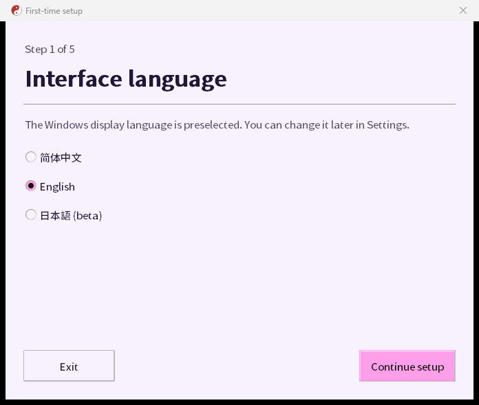
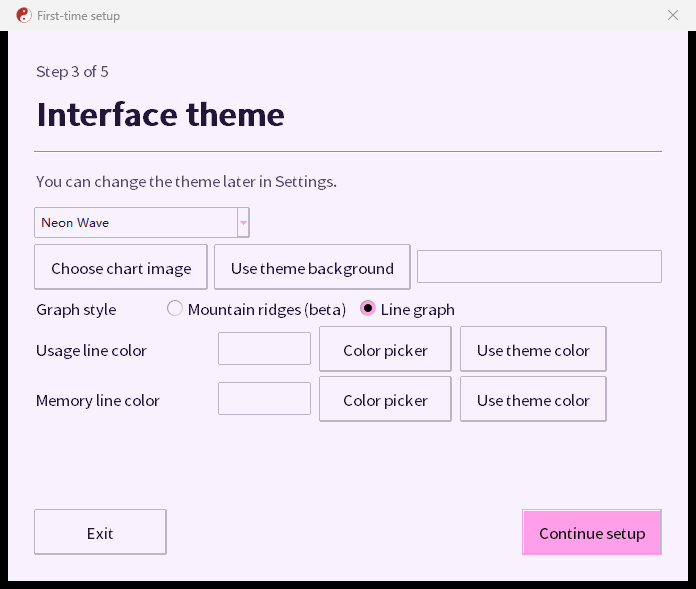
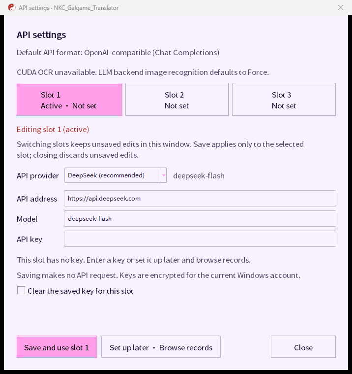
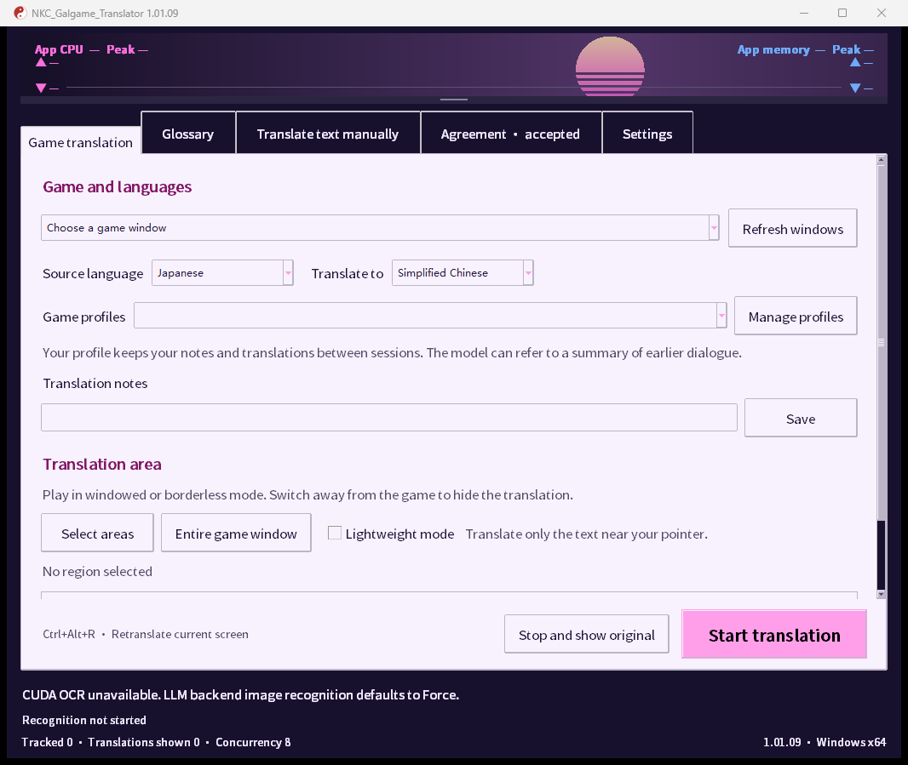

# NKC_Galgame_Translator

[English](README.md) · [简体中文](README.zh-CN.md) · [日本語 (beta)](README.ja.md)

辞書を引く手を休めて、物語の続きを。ゲームのセリフや選択肢を OCR で読み取り、文字の周囲から背景色を採取して、元の位置に訳文を表示します。選択肢はそのままクリックでき、会話もいつも通りに進められます。

**NKC** は「二色蝶」の仮名読みの頭文字を取った略称です。

**ビジュアルノベルの自動翻訳・ローカライズツール** · 中国の翻訳コミュニティでいう「自动化烤肉机」。プレイ中は台詞を元の位置で読み、翻訳作業ではページの画像と原文・訳文の組を保存して校正に使えます。

**Windows x64 · 1.01.12 · MIT**

## はじめに

リリースの添付ファイルから `NKC_Galgame_Translator-1.01.12-setup.exe` を入手してください。Portable 版を使う場合は Windows x64 の ZIP を展開し、`NKC_Galgame_Translator.exe` を起動します。CPU で Local OCR を利用できます。対応する NVIDIA GPU があれば、別配布の CUDA OCR も利用できます。手順の画像は英語表示です。

初期設定では、1 回の起動中に送信できる Request 数は無制限です。上限は設定で変更できます。利用料金と利用制限は接続先の Provider に従います。

[オプションの CUDA Add-on](https://github.com/Sabour1NX/NKC_Galgame_Translator/releases/download/v1.01.12-install.4/NKC_Galgame_Translator-1.01.12-cuda-addon.zip)

### WinGet

[WinGet manifest](https://github.com/Sabour1NX/NKC_Galgame_Translator/releases/download/v1.01.12-install.5/winget-manifest.zip) を展開します。WinGet の Local manifest を有効にし、展開先の親 Directory で次の Command を実行します。

```powershell
winget install --manifest .\winget
```

### 1. 表示言語と Chart を選ぶ

インストール先を選ぶと進捗が表示されます。完了画面から直接起動するか、Browser でガイドを開き、最後のページから起動できます。削除は Windows の「設定 → アプリ → インストールされているアプリ」から行えます。Portable 版の初回起動時には、まず表示言語を選びます。利用規約を確認して同意したら、テーマ、OCR、翻訳チーム用ツールの設定に進みます。



どのテーマでも、最初は折れ線（Line graph）が選ばれています。Graph style で Mountain ridges (beta) を選ぶと、CPU または GPU の使用率に山並みが付きます。RAM と VRAM の使用量は常に折れ線で表示されます。折れ線の頂点が密集する箇所では、新しい稜線を省きます。後から「設定」のテーマ欄でも変更できます。変更後は設定を保存してください。



### 2. 翻訳用の Model に接続する

「設定」で API 接続設定を開きます。Slot を選んで接続先の URL、Model ID、API Key を入力し、その Slot を保存して使用します。接続形式は OpenAI 互換の Chat Completions です。Ollama などの Local Server を使う場合は先に Server を起動し、そこで利用できる Model ID を入力してください。認証が不要なら API Key は空欄にできます。



読み取った原文と関連するゲームの文脈が、指定した Backend に送られます。Backend による画像認識を有効にすると、選択範囲の画像も送られます。接続先を後で決めたい場合は Set up later を選べば、保存済みの履歴を先に確認できます。

### 3. ゲームの翻訳を始める

ゲームを Window モードまたは Borderless モードで開きます。「ゲーム翻訳」で対象の Window と原文・訳文の言語を選びます。Select areas でセリフ欄を一つ以上囲むか、Entire game window を選んでください。Start translation を押したらゲームに戻ります。読み飛ばされた行には Pointer を近づけてください。軽量モードでは Pointer の周囲だけを翻訳します。



続きから遊ぶときは、同じ Profile を選ぶと用語や文脈を引き継げます。翻訳チーム用ツールでは、ページごとの Screenshot と対訳を保存し、TXT、JSON、CSV で書き出せます。

## 初回設定をもう一度試す

展開先の **Preview-Setup.cmd** をダブルクリックします。複数のバージョンがある開発環境では、プロジェクト直下の同じ Script が、使用可能な最新の公開 Build を選びます。毎回、新しい一時 Profile で実際の初回設定が開きます。アプリを閉じると体験用の設定が削除され、普段の API Key とゲームの記録はそのまま使えます。

[日本語の操作ガイド](docs/PROJECT_MANUAL.ja.html) · [初回ガイド](docs/Greeting.ja.html) · [変更履歴](CHANGELOG.md) · [MIT License](LICENSE) · [Third-party notices](THIRD_PARTY_NOTICES.md)
