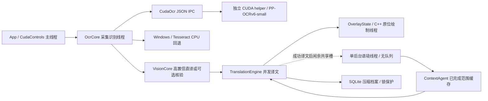
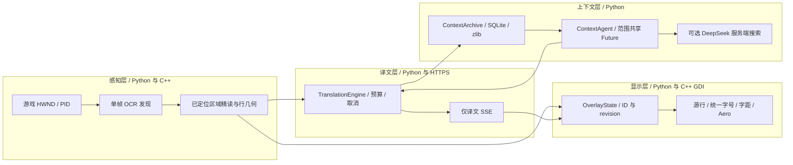
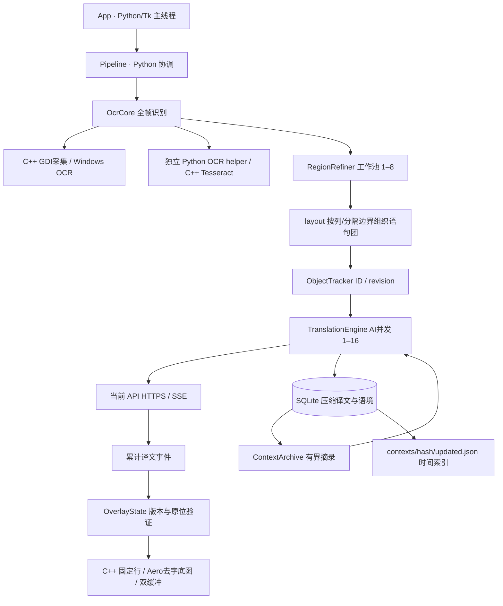

# 项目结构、语言与线程 · 0.01.27

## 0.01.27 实际运行结构



CUDA helper 独立于主 GUI；CPU 回退沿用原识别流程。后台语境最多一个线程并共享网络限额，不为每个文字框另开搜索进程。显示层只收到译文和本地几何。

## 0.01.27 CUDA 模块与 IPC

| 模块 / 类 | 语言 | 职责 |
|---|---|---|
| `cuda_ocr.py` / `CudaOcr` | Python / MIT | 本地 JSON IPC 客户端；隐藏 helper 进程、图片路径、响应限额、生命周期，不在 GUI 导入深度学习库 |
| `tools/cuda_ocr_helper.py` / `Engine` | 独立 Python helper | RapidOCR / ONNX Runtime CUDA、PP-OCRv6-small 检测与识别；验证实际 CUDA kernel 执行证据 |
| `cuda_settings_ui.py` / `CudaControls` | Python / Tk | 首次语言页与普通设置共享开关、线性系数滑条及显存预算；不探测/下载模型 |
| `OcrCore` | Python | `auto` 且 en/ja/zh 时尝试 GPU，失败后同帧回退已有 CPU 路径；返回实际 `cuda_status` |

`CudaOcr(root, memory_mb=1024, quality=75)`；`available()` 仅检查必要文件；`recognize(image, language='en')` 串行交换；`close()` 关闭 helper 并清理临时图片。识别请求仅 `image_path/language`；`warmup()` 发送 `{"warmup":true}`，仅用合成张量验证模型和 CUDA，不采屏、不联网；`cancel()` 可中止 helper，取消的实例不可复用。图片必须处于 helper 允许的本地临时目录，stdin 命令不执行为代码。响应有 `lines/ocr_ms/cuda`，最多 512 行、总文本 64000 字符、完整响应 1 MiB；坐标须位于图片内，置信度为有限 0–100 数值。GPU 接受条件包括 `CUDAExecutionProvider` 和 `kernels_verified=true`，不是仅根据 provider 列表判断。

状态包括 `disabled/ready/active/not_installed/failed/cpu_mode/pixel_priority/unsupported_language`；`ready` 不代表已完成推理。依赖与模型按版本和 SHA 锁定，见 `requirements-cuda.lock`、`CUDA_DEPENDENCY_MANIFEST.json`、`models/cuda/manifest.json`。模型/组件的授权声明由发行清单提供；安装或验收失败必须维持 CPU 路径，不能伪报 GPU 加速。

## 0.01.27 首文不等待联网参考

`TranslationEngine.translate()` 只读取已完成的 `ContextAgent.peek(key)`，立即以当前原文、手动语境与已有历史发起无工具的译文请求。成功译文完成并释放网络槽后，才调用 `refresh()` 尝试后台检索；新参考供后续语句使用，不回改已显示的译文，也不进入覆盖事件。

后台最多一个作业、无等待队列；相同范围共享结果，范围键包含游戏、可执行身份、源/目标语言与用户语境。最多 32 项缓存，有摘要 900 秒，无摘要或失败 30 秒。背景请求共用并发、次数、token 统计与取消；有前台等待者时让位，并发上限为 1 时不占用唯一显示槽。预算余量不足时优先译文；关闭先取消 transport，再等待背景线程退出。

搜索失败不会丢掉已经成功的译文；认证/余额错误的背景状态记为不可用并冷却，显示请求自身的错误仍报告。状态 `searching` 只表示后台工作，`searched` 需最终服务端来源证据。游戏、历史、网页和摘要都是 JSON 中的不可信参考；无本地工具执行、无返回 URL 自动访问、无密钥进入提示。

## 0.01.27 整组拟合与短续行

同一段正文以源行墨迹高度的中位数作稳定参考。至少三行且有至少两条宽正文、宽正文占多数时，极短续行或明显低墨迹行不单独把整组压成极小字号。单个 Region 内，短续行溢出可尝试把完整字簇分配到紧邻前行已测得的空余宽度，最多检查 64 个候选且续行至少保留一簇；行框不扩大。不能容纳的弱证据行保留原文字像素。跨 Region 不挪动文字；普通、中宽长译文仍约束共同字号。

流式阶段显示当前参考字号能容纳的前缀，完整译文仍累计保存；完成后再执行整组拟合和满宽字距。标题、列、源字号/风格、固定字号与显式字号上限边界保留。少数弱框可能仍显示原文，流式尾部可能等到 final 后出现。这是显示修复，不代表 OCR 或语义翻译准确率提高。

不新增用户配置，不改变 ABI 2 或原有导出签名；原生诊断新增 `font_intrinsic_px` 与 `lines[].drawable`。`fits=true` 表示可靠约束行已拟合，弱异常行仍可能 `drawable=false`，逐行可见性应检查该字段。本版 C++ 核心需要重新编译与验收，旧版 native audit 不构成本版二进制证据。

## 0.01.27 窗口身份与运行状态

`window_metadata(hwnd, paths=None)` 返回 `hwnd,pid,title,process_path,exe_name,class_name`；刷新列表时按 PID 共享进程路径查询。`translation_target(row)` 是基于元数据的目标筛选，不按游戏名或引擎白名单判断。资源管理器、桌面、任务栏、系统辅助进程/窗口类及本程序覆盖层不作为候选。列表显示“标题 · 可执行文件名 · PID”。

`App.chosen_window()` 选择时重新读取元数据并检查 HWND/PID，拒绝过期身份和系统辅助窗口。`window_state(hwnd, expected_pid)` 返回 `closed / replaced / minimized / hidden / background / active`；此查询不打开进程。`App._refresh_running_status()` 最多每秒刷新一次，结合目标状态和管线事件区分等待、识别、未找到文字、AI 请求与已显示译文；实际错误保持锁存直到停止或重启。状态文本不是翻译完成证据：后台、最小化或不可见选区不会继续截图翻译。源/目标语言、1–8 选区、截图选项、字体与字距行为不变。


0.01.27 加入可选 CUDA OCR、后台联网语境与整组字号修复。本版新增同图 OCR 评审，对照 0.01.15，分别报告冷启动、背景变化热路径、复访缓存和逐字精度；真实 API 链路另列。历史证据保留原版本标签，当前方法与范围见性能报告及 TEST_REPORT.json。

## 0.01.27 Harness 层与类



`nkc_galgame_translator/context_agent.py` 组织受限背景请求及结果，不执行模型工具代码。`ContextAgent.peek/refresh` 让显示读取已有参考、成功译文后后台刷新；内部 `resolve` 按游戏身份、语言对和用户语境共享在途 Future，最多 32 个缓存条目；有摘要参考保留 900 秒，失败或空摘要冷却 30 秒。服务端搜索与译文共用引擎并发和计数，具体契约见 [CONTEXT_AGENT.md](CONTEXT_AGENT.md)。

`fixed_layout.h` 的固定参考字形校准不随本次 token 的笔画高度放大。原生线程在 final 完成时联合拟合同风格连续正文组，普通长行约束共享字号，符合条件的弱续行不单独压小整组；流式阶段先显示可容纳前缀。该显示关联不合并文本、请求、矩形或选区；每行原位置和满宽字距保留。`font_peers` 是诊断中参与共同字号的 Region 数，默认 1。标题、不同源字号/样式/显式上限、不同列和较大段落间隔不联动。

适用版本：0.01.27 · 文档复核：2026-11-18。历史记录保留原版号。

## 多区域与字体模块

```text
nkc_galgame_translator/
  selection_regions.py  Python: CapturePlan、区域裁切、遮罩、分组边界
  font_style.py         Python/Pillow: SourceStyleMatcher、TargetFontSelector
  app.py                Python/Tk: 连续框选、确认/撤销、窗口身份
  ocr.py / vision_core.py Python: 单帧遮罩、选区过滤、源字体元数据
  pipeline.py / tracking.py Python: 选区隔离、最新帧、并发翻译
native/
  core.cpp / core.h     C++17/GDI: 字形覆盖验证、逐框字体导出
  fixed_layout.h        C++17/GDI: 同字体测量与原行排版
```

一个捕获线程服务全部选区；已有 OCR helper 和有界细化池继续复用，不按选区增加 OCR 进程或线程。字体风格分析在 OCR 工作线程，选择已安装目标字体及渲染提交在显示路径；GDI 绘制仍由独立原生线程执行。256 项字体风格/覆盖缓存分别有界，精确帧缓存还包含选区和自动字体开关。



## 目录与职责

```text
0.01.27/
├─ main.py / Start.ps1                 入口与便携启动
├─ nkc_galgame_translator/
│  ├─ app.py                          五页界面、窗口、档案、事件
│  ├─ settings_ui.py / tuning.py       可调参数与严格校验
│  ├─ setup_ui.py / config_store.py    三槽位、Windows DPAPI、原子配置
│  ├─ pipeline.py                     采集、最新观测队列、翻译调度
│  ├─ ocr.py / ocr_regions.py          全帧识别、线程墨迹细化与分隔线
│  ├─ layout.py                       同列语句团、单元格屏障、源行
│  ├─ tracking.py / presentation.py    对象关联、过期事件拒绝、稳定矩形
│  ├─ translation.py                  纯AI请求、预算、SSE、在途合并
│  ├─ context_archive.py              压缩记录、参考摘录、更新时间
│  ├─ vision.py / vision_core.py       可选图像精读，真实本地锚框
│  ├─ dictionary_import.py            保留历史术语导入
│  ├─ security.py / input_paths.py     外部输入与路径校验
│  └─ native.py                       ctypes ABI桥接和生命周期
├─ native/core.cpp / core.h           C++17/WinRT/GDI捕获与绘制
├─ native/fixed_layout.h              原行、墨迹字号、字距、缩字
├─ native/aero_background.h           字形掩模局部修补、非字背景保真
├─ tools/ocr_helper.py                独立受限OCR进程
├─ config/                           公开示例与本机加密配置
├─ data/codebook.sqlite3              历史词典、译文、压缩语境
├─ data/contexts/<scope_id>/updated.json  每范围时间索引
├─ docs/ / tests/ / tools/            文档、回归、构建和核验
└─ dist/                             公开便携程序与对应源码包
```

`expert.py` 已移除，不新增翻译模型依赖。OCR 和防误识规则仍可在本地执行；“纯 AI”描述译文生成路线，并不要求把每个图像处理步骤发到网络。

## 类与并发

| 类/模块 | 语言 | 作用及线程约束 |
|---|---|---|
| `App`, `SettingsPanel`, `ApiSettingsDialog` | Python/Tk | 主线程拥有所有控件；后台只投递数据 |
| `Pipeline` | Python | 单采集线程、单协调线程；观测队列容量1只保留最新帧；最多32对象 |
| `OcrCore`, `PortableOcr` | Python | 完整选区识别后细化；外部 helper 独立进程，不在 GUI 加载 Tesseract |
| `RegionRefiner` | Python/Pillow | 1–8线程，默认4；一次最多512行，像素预算不超过400万 |
| `ObjectTracker` | Python | 1–4匹配线程，稳定ID和文字revision；GIL限制CPU并行增益 |
| `TranslationEngine` | Python/httpx | 1–16在途请求；API网络I/O可并发，同键只合并当前任务 |
| `ContextArchive` | Python/SQLite/zlib | 由引擎锁串行访问数据库；成功事务后原子更新时间索引 |
| `ContextAgent`, `ContextReference` | Python/httpx | 按范围共享背景请求；服务端搜索证据、有界摘要和来源；不接管布局或本机操作 |
| `OverlayState` | Python | 会话、对象、修订校验；文本几何整体确认，拒绝迟到结果 |
| `Context`, `OverlayWindow` | C++ | 独立覆盖线程，采集/背景/覆盖各自锁，GDI双缓冲 |

背景帧是不可变副本，覆盖线程不等待 OCR 的长时识别锁。Aero 底图按原帧与行几何复用，总纹理预算64MiB；底图只修补字形掩模，非掩模RGB保持原像素；不确定时抑制该框译文。全帧识别之后的分解与翻译可并行，不把同一张截图的随机碎片各自识别后再猜测全局布局。

## 窗口拖动跟随接口

`gl_overlay_anchored(context, regions, count, rows, row_count, offsets, origins)` 是 ABI 2 的新增导出。前六项与 `gl_overlay_fixed` 相同；`origins` 为 `2*count` 个 int32，逐项保存生成文字对象时的屏幕捕获原点 `(x,y)`。Python `NativeCore.show_overlay()` 从各对象的 `_capture_origin` 校验并构建数组，不把模型输出作为坐标。所有对象提供原点时使用新接口，否则走原有入口。

提交时将绝对 OCR 坐标换算为游戏客户区局部坐标，原生线程每 16 毫秒检查客户区位置，以 `SetWindowPos` 只移动覆盖 HWND，不重新翻译、不重新拟合字体、不抢焦点。即使后续 token 携带旧捕获原点，也不会跳回旧窗口位置。系统调度决定实际延迟，16 毫秒是检查周期而非延迟保证。

源行局部坐标保持不变；背景采样按对应帧的客户区原点重定位。窗口大小变化时隐藏旧尺寸覆盖，等待新的识别布局；最小化、失焦、越出客户区或虚拟屏幕时隐藏。原生捕获遇到瞬时移动、缩放或尚无首帧时返回 `changed:false,pending:true,lines:[]`，OCR/VisionCore 转发，Pipeline 不确认旧行、不发新请求，下一周期重试。不可恢复的接口错误仍终止当前捕获并显示错误。

## 0.01.22 新模块

`nkc_galgame_translator/frame_cache.py` 的 FrameCache：Python 有界整帧 OCR LRU，16 项 / 128 MiB 预算。OcrCore 负责锁和当前坐标换算，翻译引擎仍走 API；TranslationEngine 增加在途部分结果共享。没有修改 C++ DLL。

## 0.01.23 颜色识别模块

`tools/ocr_helper.py`（Python / Pillow，独立 MIT）负责 RGB 局部对比与 ContrastCache；Tesseract（C++）仍负责字符与词框识别。`nkc_galgame_translator/ocr.py`（Python）扩展自动模式的平坦彩色画面判定，并继续在原图上测量前背景与源墨迹。C++ 捕获 / 绘制 DLL 未修改。没有新增依赖或线程。
