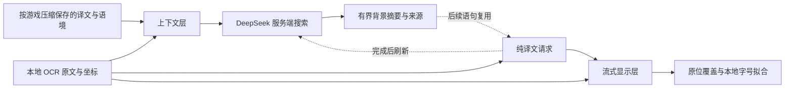

# 联网理解与显示分层 · 0.01.27

在设置页的「翻译上下文长度（字符）」输入 512–16384，默认 4096。这个上限约束每次翻译的参考资料，当前待译原文单独提交。独立摘要的目标长度随预算调整，为 128–2048 字符。保存设置后用于下一次启动的翻译任务。

## 0.01.27 后台语境接口

| 方法 | 契约 |
|---|---|
| `ContextAgent.peek(key)` | 只读已完成同范围参考；不等待 Future；不可用时返回空参考 |
| `ContextAgent.refresh(key, request, check_open, on_done=...)` | 尝试启动单个后台线程，无队列；返回是否启动。引擎先占共享网络槽，`on_done` 在取消/异常/正常路径统一归还 |
| `ContextAgent.close()` | 在引擎取消 transport 后关闭并 join；不得持引擎锁等待 |
| `ContextAgent.resolve(...)` | 内部/兼容同步单 flight 原语；实时译文入口不再同步调用它 |
| `status().background_active` | 后台工作是否存在；与显示结果独立 |

## 0.01.27 首文不等待联网参考

`TranslationEngine.translate()` 只读取已完成的 `ContextAgent.peek(key)`，立即以当前原文、手动语境与已有历史发起无工具的译文请求。成功译文完成并释放网络槽后，才调用 `refresh()` 尝试后台检索；新参考供后续语句使用，不回改已显示的译文，也不进入覆盖事件。

后台最多一个作业、无等待队列；相同范围共享结果，范围键包含游戏、可执行身份、源/目标语言与用户语境。最多 32 项缓存，有摘要 900 秒，无摘要或失败 30 秒。背景请求共用并发、次数、token 统计与取消；有前台等待者时让位，并发上限为 1 时不占用唯一显示槽。预算余量不足时优先译文；关闭先取消 transport，再等待背景线程退出。

搜索失败不会丢掉已经成功的译文；认证/余额错误的背景状态记为不可用并冷却，显示请求自身的错误仍报告。状态 `searching` 只表示后台工作，`searched` 需最终服务端来源证据。游戏、历史、网页和摘要都是 JSON 中的不可信参考；无本地工具执行、无返回 URL 自动访问、无密钥进入提示。

0.01.27 加入可选 CUDA OCR、后台联网语境与整组字号修复。本版新增同图 OCR 评审，对照 0.01.15，分别报告冷启动、背景变化热路径、复访缓存和逐字精度；真实 API 链路另列。历史证据保留原版本标签，当前方法与范围见性能报告及 TEST_REPORT.json。

二色蝶是围绕模型运行的游戏翻译 Harness：程序负责截图范围、识别、对象追踪、上下文筛选、工具声明、预算、取消与原位显示；模型负责理解语境和生成译文。`ContextAgent` 是 Harness 调度的受限上下文子任务，不是能够独立执行命令的开放 Agent。引擎把“理解所需的数据”和“屏幕上实际显示的文字”作为不同接口管理。

在「设置 → 上下文层与显示层」开启「联网理解游戏背景（DeepSeek Flash）」。公开发行默认关闭，已配置的个人演示版可以开启。开关保存后在下次翻译使用。

上下文层使用游戏档案、填写的语境及首段原文摘录（最多 1200 字符），让 DeepSeek 查询游戏背景、语气和专名。显示层只接收当前原文的译文；搜索来源、推理、搜索进度与背景摘要不显示在游戏上，也不能改变本地检测的坐标或字号。

模型自行决定是否搜索。设置中会明确区分「已取得搜索来源」「模型未使用搜索」「搜索未返回来源」「暂不可用」等状态。仅把工具返回的已完成调用作为搜索证据；模型在正文中声称“已搜索”不算验证。

联网理解会增加一个后台模型请求，但首段不等待该请求，并计入与翻译相同的请求额度、并发及 Token 统计。每个游戏、可执行档案身份、语言对及填写语境组合缓存 15 分钟，同步出现的多个文字框共享一次背景请求；最多缓存 32 项。摘要是游戏背景参考，并非每帧场景的完整分析。失败冷却 30 秒；只剩一次请求额度时优先生成译文。显示请求的认证、余额和权限错误直接报告；背景失败标为不可用并冷却，不伪装成搜索成功。

搜索暂不可用时直接翻译，原有压缩历史仍作为参考。网络请求可能等待配置的超时时长；本功能不会让文字识别自动变准，无法读清的原文仍需 OCR 校验。官方 DeepSeek `deepseek-flash` 使用 Chat Completions 的 `deepseek_web_search` 服务端工具。其他 OpenAI 兼容端点保留普通翻译，不擅自发送厂商扩展。

外部网页、游戏原文、用户填写的语境和历史摘要均作为不可信参考。客户端不执行模型提供的函数、命令或脚本，不自动访问返回 URL，也不向背景提示传递 API 密钥。网页内容仍可能错误，不能保证事实或译文百分之百准确。

## 接口

| 接口 | 输入 | 输出与约束 |
|---|---|---|
| `context_payload(model, scope, text, context, max_tokens)` | 已校验模型；游戏/源语言/目标语言；原文；用户语境 | 仅声明 `deepseek_web_search`；`thinking=disabled`；无本地工具；摘录 1200 字符、语境 2000 字符 |
| `ContextAgent.resolve(key, request, check_open)` | 范围键；由引擎提供的请求函数与取消检查 | `ContextReference`；同键并发共享 Future；32 项 LRU；成功有摘要 900 秒、无摘要 30 秒 |
| `search_evidence(steps)` | 最终 `delta.server_tool_calls` | HTTPS/HTTP 来源最多 6 个；每个 URL 2048 字符、标题 160 字符；忽略 reasoning、未知工具和未完成调用 |
| `combine_context(history, reference, limit)` | 压缩历史摘录；背景参考；完整提示预算 | `history_reference` / `web_reference` 分离的 JSON 数据，不超过 `context_max_chars` |
| `TranslationEngine.get_context_agent_status()` | 无 | `enabled/status/summary/sources/search_calls/cache_hits/cache_entries/background_active`；供状态和诊断读取，不供覆盖显示 |
| `TranslationEngine.get_stats()` | 无 | 新增 `context_requests/context_failures/context_search_calls/context_cache_hits/context_sources/context_agent_status/context_web_search`；`session_requests` 同时包括上下文与译文请求 |

`TranslationEngine.translate(game, source_lang, target_lang, text, on_chunk, context, warmup_scope=...)` 是 Harness 的译文入口，签名保持兼容。读取已有受限背景参考后立即进行纯译文请求；新背景检索在成功译文之后启动；`on_chunk` 只接收累积译文，不接收搜索元数据或推理文本。坐标、选区、源行、字号等显示信息不由模型返回，也不经 `ContextAgent` 修改。

传输沿用有界 SSE：完整响应 2 MiB、单行 128 KiB、单事件 256 KiB、最多 8192 事件。背景理解最多尝试一次；直接翻译仍遵守现有重试设置。背景摘要与来源随成功译文的 `prompt_context` 压缩保存；推理内容不保存。

官方格式依据：[DeepSeek Web Tools](https://api-docs.deepseek.com/guides/web_tools/)（核对日期 2026-11-18）。本实现采用已支持的服务端工具接口，不宣称启用了任意代码执行 Agent。
