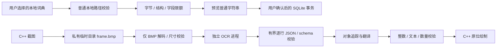

# 0.01.30 新增短按钮布局接口

Windows x64 C ABI 2 增加 gl_overlay_labels，保留原有导出签名。调用参数沿用 gl_overlay_styled，最后增加长度为 count 的 int32_t 数组。0 为普通布局，1 为单行居中布局。标记 1 的区域须提供一个有效原文行。原文行的 ink_* 仍指实际字形；row.width 为已验证的排版宽度。没有自定义字体时 families 和 pixel_fonts 可同时为 NULL。失败返回 0，错误通过 gl_error 读取，未提交不完整批次。

# 输入、OCR 与原生边界接口 · 0.01.27

## 0.01.27 CUDA 模块与 IPC

| 模块 / 类 | 语言 | 职责 |
|---|---|---|
| `cuda_ocr.py` / `CudaOcr` | Python / MIT | 本地 JSON IPC 客户端；隐藏 helper 进程、图片路径、响应限额、生命周期，不在 GUI 导入深度学习库 |
| `tools/cuda_ocr_helper.py` / `Engine` | 独立 Python helper | RapidOCR / ONNX Runtime CUDA、PP-OCRv6-small 检测与识别；验证实际 CUDA kernel 执行证据 |
| `cuda_settings_ui.py` / `CudaControls` | Python / Tk | 首次语言页与普通设置共享开关、线性系数滑条及显存预算；不探测/下载模型 |
| `OcrCore` | Python | `auto` 且 en/ja/zh 时尝试 GPU，失败后同帧回退已有 CPU 路径；返回实际 `cuda_status` |

`CudaOcr(root, memory_mb=1024, quality=75)`；`available()` 仅检查必要文件；`recognize(image, language='en')` 串行交换；`close()` 关闭 helper 并清理临时图片。识别请求仅 `image_path/language`；`warmup()` 发送 `{"warmup":true}`，仅用合成张量验证模型和 CUDA，不采屏、不联网；`cancel()` 可中止 helper，取消的实例不可复用。图片必须处于 helper 允许的本地临时目录，stdin 命令不执行为代码。响应有 `lines/ocr_ms/cuda`，最多 512 行、总文本 64000 字符、完整响应 1 MiB；坐标须位于图片内，置信度为有限 0–100 数值。GPU 接受条件包括 `CUDAExecutionProvider` 和 `kernels_verified=true`，不是仅根据 provider 列表判断。

状态包括 `disabled/ready/active/not_installed/failed/cpu_mode/pixel_priority/unsupported_language`；`ready` 不代表已完成推理。依赖与模型按版本和 SHA 锁定，见 `requirements-cuda.lock`、`CUDA_DEPENDENCY_MANIFEST.json`、`models/cuda/manifest.json`。模型/组件的授权声明由发行清单提供；安装或验收失败必须维持 CPU 路径，不能伪报 GPU 加速。

## 0.01.27 CUDA 识别与实际回退

首次语言设置和常规设置共用 CUDA 控件。`cuda_enabled` 默认开启；只在 OCR **自动模式**且源语言为英语、日语或中文时尝试 CUDA。手动 Windows / Pixel 模式明确走 CPU；自动模式检测到经典英语像素画面且便携识别可用时优先 CPU Pixel 路径（`pixel_priority`）；其他语言继续使用已有本地识别。组件缺失、无兼容 GPU、模型校验或推理失败时回退 Windows / Tesseract，并显示实际状态，不能把“文件已安装”当作“CUDA 已运行”。失败后的当前 OCR 实例不反复重试 GPU，修改设置后停止并重新开始。

| 设置 | 默认 | 范围与作用 |
|---|---|---|
| `cuda_enabled` | `true` | 开关；不自动下载或安装组件 |
| `cuda_quality` | `75` | 0–100，高性能到高精度；线性调节检测长边，按 32 像素量化 |
| `cuda_memory_mb` | `1024` | 256–16384 MiB；推理内存 arena 预算，不会强行占满 1 GiB，运行库和驱动另有开销 |

检测长边约为 `768 + 11.52 × cuda_quality` 后按 32 像素量化；75 对应 1632 像素。仅缩小超出上限的图像，小图在不同档位可能等效；数值不是准确率百分比，也不保证单调提速或提高精度。CUDA 模型为 PP-OCRv6-small，GPU/依赖验证结果以本版报告为准，不提前声称所有 NVIDIA 显卡可用。

启用可选云端 AI 图像精读时，CUDA 已输出的行仅在置信度不低于 95 且没有拒绝标记时直接送译，其余仍走核验路径。**95 是模型分数门槛，不是 95% 实测准确率承诺**。CUDA 本地 OCR 不上传图片；云端精读仍遵循独立开关和图片发送规则。

0.01.27 加入可选 CUDA OCR、后台联网语境与整组字号修复。本版新增同图 OCR 评审，对照 0.01.15，分别报告冷启动、背景变化热路径、复访缓存和逐字精度；真实 API 链路另列。历史证据保留原版本标签，当前方法与范围见性能报告及 TEST_REPORT.json。

## 0.01.27 感知候选与图像精读

`OcrCore.recognize_image` / `capture_ocr` 可额外返回 `vision_anchors`，最多 128 个已测量候选。字段为 `text,x,y,w,h,bg,fg,confidence,_source_ink,_vision_only=True`。低置信候选仅向明确启用的 AI 图像精读提供定位，不进入普通译文显示或成功档案；常规本地行仍遵守配置置信阈值（默认 55）。候选同时接受选区过滤与坐标换算。

`tools/ocr_helper.py` 的 `find_text_surfaces`、`surface_rows`、`read_text_surfaces`、`merge_surface_detections` 在全帧发现后检测局部平色面板，按 RGB 对比归一化和物理行精读；不硬编码游戏坐标。填色按钮等过大的块状对象不作为文字行。helper 保留普通行最多 512、候选最多 128、合计文本 64000 字符、JSON 响应 1 MiB 的限制，所有文本、有限置信值和几何边界均校验。

可选 Vision 请求包含同一已选游戏区域的完整原图，以及最多 32 张小字局部放大图；局部放大图合计像素预算 200 万、PNG 原始字节预算 4 MiB。完整原图仍遵守既有图像和 HTTP 限制。模型只能精读本地锚框对应的原文，不能返回任意新坐标；没有可靠本地定位的文字仍保留原图。不支持图像输入的服务商/模型不能因名称相似就启用此能力。联网背景搜索与图像精读是独立开关，搜索不能替代 OCR。

## 0.01.27 上下文边界

可选上下文层只声明 DeepSeek 服务端联网搜索工具，之后的纯译文请求不声明工具。两层共用额度、并发与 Token 统计。游戏文字、历史、网页与摘要都是不可信参考，客户端不自动访问返回 URL、不执行函数或命令，也不让模型改变本地原文坐标。精确请求、元数据、超时与缓存契约见 [CONTEXT_AGENT.md](CONTEXT_AGENT.md)。

适用版本：0.01.27 · 文档复核：2026-11-18。历史记录保留原版号。

## 多区域与字体接口

| 接口/字段 | 输入、返回与约束 |
|---|---|
| `selection_regions.capture_plan(value)` | `None`、旧单矩形 `(x,y,w,h)` 或 1–8 矩形列表；返回不可变 `CapturePlan(bounds, regions)`；坐标为整数，拒绝 bool、重叠和超限；非法值抛 `ValueError` |
| `CapturePlan.bounds / regions` | bounds 是绝对屏幕外接矩形；regions 是相对该外接矩形的不可变局部矩形元组；联合宽高各 ≤4096 |
| `client_selections(relative, client)` | 游戏相对坐标裁到当前客户区并转屏幕坐标；全部在外返回 None；不捕获邻近应用 |
| `OcrCore.set_capture_regions(regions)` | 在一次捕获前设置局部选区；改变范围使捕获失效；范围进入整帧缓存键 |
| `prepare_capture_image(image)` | 返回调用者拥有的 RGB PIL 图像；框外间隙黑色，不修改源图；Vision 上传前也应用此规则 |
| `_selection_id` | 本地整数边界；布局、AI 锚框整理、跟踪均不得跨此边界合并 |
| `SourceStyleMatcher.classify(image,line)` | 图像坐标 OCR 行 → sans / serif / mono / pixel；单框最多 65536 像素、96 个源字符；256 项有界缓存，无网络 |
| `TargetFontSelector.choose(style,text)` | 目标语种样本 + 实际译文字符验证；返回 `(family,pixel)` 或 None；最多4096个不同BMP字符，256项缓存 |
| `set_auto_font_style(enabled,target)` | 布尔开关与目标语言代码；停止后配置；手动字体不丢失 |
| `_source_font_style` | OCR 本地源图证据附加元数据；传给译文，不作为模型指令或外部字体路径 |
| `gl_font_supports(family,text)` | C ABI 新导出；名称1–31 UTF-16单位，文本≤4096；确认安装字体并检查字形，返回1/0；补充平面字符保守返回0 |
| `gl_overlay_styled(ctx,regions,count,rows,row_count,offsets,origins,families,pixel_fonts)` | 继承 `gl_overlay_anchored` 布局；origins诊断时可null；families/count、pixel_flags/count并行数组，flags限0/1。验证失败返回0，不提交部分结果。沿用ABI2、GLRegion56字节 |

新增配置 `auto_font_style: bool = false`，属于外观参数。原来的手动字体、字号和流式行为接口兼容。每框字体在原生渲染线程用于测量和绘制；像素风格关闭平滑，其余使用 ClearType。Python/Tk 主线程不直接执行 OCR。

字形检查依据 [GetGlyphIndicesW](https://learn.microsoft.com/en-us/windows/win32/api/wingdi/nf-wingdi-getglyphindicesw)，渲染质量依据 [CreateFontW](https://learn.microsoft.com/en-us/windows/win32/api/wingdi/nf-wingdi-createfontw)。这些检查不替代复杂文字排版引擎。

本页是 0.01.20 的补充接口契约，与 [API.md](API.md) 中的 ABI 和事件协议配套。下面的限制在代码中实施，不代表操作系统沙箱或对恶意本机进程的防护。所有源码路径相对于版本目录。

## 数据流与信任边界



词典和 OCR 内容始终是字符串数据。这里没有 `eval`、脚本规则、Shell 命令生成、自动打开链接或执行模型输出。翻译模型边界另见 [SECURITY.md](SECURITY.md)。

## 普通本地文件路径

`nkc_galgame_translator.input_paths.local_file_path(value: str | os.PathLike) -> pathlib.Path`

- 返回绝对路径；不展开环境变量、不下载 URL，不执行 Shell。
- 长度 1–32700 字符，不含 ASCII 控制字符。禁止 UNC、设备命名空间、备用数据流（ADS）、保留设备名、尾随点/空格组件；相对 `.`/`..` 可正常定位普通文件。
- Windows 驱动器只能为本地固定/可移动/光盘/RAM 盘。网络映射盘和不可用驱动器拒绝。
- 所有路径组件不得是符号链接或重解析点；末项须为普通文件。这意味着应先把云盘占位文件、链接目录或网络共享上的词典复制到普通本地目录。
- 路径不符合约定抛 `ValueError`，文件不存在/权限不足等可抛 `OSError`。上层词典导入转换为不含路径和正文的 `DictionaryImportError`；DLL 加载转换为固定 `RuntimeError`。

该检查用于减少意外访问网络资源、设备或错误文件。检查与打开之间仍存在同账户进程替换文件的竞态；本软件没有阻止本机攻击者修改安装目录的权限边界。

## 词典解析接口

```python
parse_dictionary(path, source_lang: str, target_lang: str) -> list[dict[str, str]]
class DictionaryImportError(ValueError): ...
```

| 项目 | 约定 |
|---|---|
| 输入文件 | `.csv` / `.tsv` / `.json` / `.tmx` 普通本地文件 |
| 文件读取 | 先看大小，再最多读取 20 MiB + 1 字节，防止读取中增长绕过限制 |
| 编码 | UTF-8、UTF-8 BOM、带 BOM 的 UTF-16、GB18030；不支持 UTF-32 |
| 返回结构 | `[{"source": "Start", "target": "开始"}]`，两项均为非空普通字符串 |
| 规范化 | NFC；CRLF/CR 统一为 LF；去首尾空白；保留内部换行和制表符 |
| 字段/记录 | 每字段 ≤4096 字符；读取记录数 ≤100000，完全相同重复记录也计入读取限额 |
| 重复项 | 同原文同译文去重；同原文不同译文拒绝整批 |
| Unicode | 拒绝孤立代理项、不支持的控制字符和 NUL；`\n` / `\t` 允许 |
| JSON | 映射或 source/target 对象数组；解析前检查最大嵌套 16 层、容器最多 100001 个；拒绝 NaN/Infinity 和冲突键 |
| TMX | 禁止 DTD/ENTITY 声明；最多 64 层、1000000 元素、100000 个 tu；只选择明确语言对，歧义拒绝 |
| 写入/联网 | 解析阶段无数据库写入、无网络、无自动下载；调用者另行预览与提交 |
| 异常 | 固定格式说明或行号，不拼接路径、文件正文、解析器原始错误 |

CSV 的列选择、TMX 语言别名和例子见 [DICTIONARIES.md](DICTIONARIES.md)。解析器是同步文件 I/O，UI 必须在工作线程调用，通过事件队列向 Tk 主线程返回结果；不得在工作线程读写 Tk 控件。解析成功不代表译文质量已被人工审核。

## 独立 OCR 进程协议

`tools/ocr_helper.py` 是独立 MIT 工具，不导入主程序包。源码调用为：

```text
.\vendor\python\python.exe -I -u tools/ocr_helper.py --packages <本地依赖目录>
       --tessdata <本地模型目录> --input-root <本次私有临时目录>
```

发行版使用 `tools/ocr_helper/ocr_helper.exe`，其余参数相同。`--input-root` 在本版新增且必填；旧的任意图片路径接口已收紧。解释器、EXE 和脚本均为确定路径，通过参数数组 `Popen` 启动，不经过 Shell。进程无窗口，stderr 不传给 UI。源码解释器使用 `-I`，启动环境移除 `PYTHONPATH/PYTHONHOME/PYTHONSTARTUP`，只显式添加项目依赖目录；OpenMP 线程上限为 2。

启动时先以启动工作目录为基准，将 `--packages`、`--tessdata`、`--input-root` 解析为绝对路径，检查模型目录与输入目录存在，然后仅在独立 helper 进程内将工作目录切换到模型目录。Tesseract 始终收到 ASCII 相对路径 `path='.'`，避免 Windows 模型加载器无法打开中文绝对路径的问题；主程序工作目录不变，不复制模型，不依赖 Windows 短文件名。目录不可用时返回固定 `{"error":"OCR working directories are unavailable"}` 并以状态码 2 退出。路径解析与存在性检查不是对恶意本机进程的沙箱隔离。

### 请求

UTF-8 JSON Lines，一条请求一行（含末尾换行），最多 16384 字符。允许字段只有 `image_path`、`language`、`quit`。

```json
{"image_path":"E:\\example\\data\\ocr-session\\frame.bmp","language":"jpn+eng"}
```

- `image_path` 必须是本次 `--input-root` 目录中的 `frame.bmp`，不得为网络路径、重解析点、NUL/控制字符路径、目录或 ADS。
- 主程序提交绝对 `image_path`；独立调用者若提交相对路径，其基准仍为 helper 的启动工作目录，而不是切换后的模型目录。相同的输入目录和 BMP 校验继续适用。
- `language` 缺省为 `jpn+eng`；允许 `jpn`、`eng`、`jpn+eng`、`chi_sim`、`chi_sim+eng`。缺模型时报固定错误，不下载资源。
- `{"quit":true}` 单独使用可退出；与其他参数混合不作为退出请求。
- 过长或缺换行的请求返回固定错误后结束进程，避免后半行被错误当成新请求。

### BMP 边界

只接受 BMP 文件头标识、40 字节 BITMAPINFOHEADER、1 个平面、24/32 位、`BI_RGB`（未压缩）。宽、高绝对值为 1–4096；像素偏移须为 54，文件长度须恰好等于偏移加按行对齐的像素字节数，且不超过 `4096*4096*4+1024` 字节。拒绝压缩 BMP、扩展头、伪后缀、截断和尾随数据。

在文件大小、头和像素长度检查之后，使用 `Image.open(..., formats=['BMP'])`，核对尺寸再加载，并转换 RGB。`set_rgb_image(engine,image) -> bytes` 检查像素缓冲长度，调用 `PyTessBaseAPI.SetImageBytes(pixels,width,height,3,width*3)`；调用者保留返回的 bytes，直到 AUTO 和可选 SPARSE_TEXT 两次识别结束。该调用传入未压缩像素，不调用 `SetImageFile` 或 `SetImage(PIL)`（后者仍经过 Leptonica 格式探测）；不把任意路径传给 Leptonica，不调用 EPS、TIFF、JPEG2000 等文件格式解码路径。上游依据：[Pillow formats 参数](https://pillow.readthedocs.io/en/stable/reference/Image.html#PIL.Image.open)、[tesserocr SetImageBytes 实现与缓冲所有权](https://raw.githubusercontent.com/sirfz/tesserocr/master/tesserocr/tesserocr.templ.pyx)。

### 响应

每行 UTF-8 JSON，正常响应最大 1048576 字节；主进程读取上限为 1048576 字符 + 检查字符（UTF-8 可能占更多字节）。生产端与消费端分别限制，不依赖对端自律。

```json
{"lines":[{"text":"ゲームを開始する","x":32,"y":30,"w":340,"h":40,"confidence":94.5}],"ocr_ms":20.1}
```

| 字段 | 主进程验证 |
|---|---|
| `lines` | 数组，最多 512 项；空数组是正常无文字结果 |
| `text` | 字符串，每行 ≤16000 字符，总计 ≤64000；无 NUL/孤立代理项 |
| `x,y,w,h` | 真正的整数（不接受 bool），非空矩形完整位于输入图片内 |
| `confidence` | 有限数值，0–100，不接受 bool、NaN 或 Infinity |
| `ocr_ms` | 有限数值，0–120000，不接受 bool、NaN 或 Infinity |
| `error` | 错误响应；不回显其原始值，主进程转为固定异常 |

`nkc_galgame_translator.ocr.validate_response(response,width,height) -> dict` 校验并返回原响应；非法字段抛 `RuntimeError`。`PortableOcr.recognize(image)` 同步运行，受实例 RLock 串行化；尺寸不合法时在创建进程前拒绝。队列容量为 2，单次等待上限 20 秒；超时、非法响应或 helper 退出时关闭进程、清理私有临时目录。下一次调用可重新创建进程。关闭先请求退出，1 秒未结束则 kill，并最多再等待 2 秒。后台读取线程不接触 Tk。

## Python → C++ 原生边界

`NativeCore` 用经过普通本地路径校验的绝对路径加载 DLL。`ctypes.CDLL(..., winmode=0x900)` 明确设置 `LOAD_LIBRARY_SEARCH_DLL_LOAD_DIR | LOAD_LIBRARY_SEARCH_SYSTEM32`；不把当前工作目录或 PATH 加入依赖搜索。Windows 对这些标志的说明见[微软文档](https://learn.microsoft.com/en-us/windows/win32/api/libloaderapi/nf-libloaderapi-loadlibraryexw)，Python 参数见[ctypes 文档](https://docs.python.org/3/library/ctypes.html#ctypes.CDLL)。

ABI 仍为 **2**，`GLRegion` 仍为 **56 字节**，保留字体设置导出并新增 gl_ocr_bgra 固定图像识别，不改变 GLRegion 二进制结构与字符串所有权。0.01.20 包装层同时检查这两个导出，因此必须使用本版 DLL，不能仅凭 ABI 数字相同混用旧 DLL。

| 方法/参数 | Python 包装层限制 |
|---|---|
| `capture_ocr/capture_bgra(x,y,w,h,...)` | int32 坐标，宽高 1–4096；拒绝 bool、小数与正向加法溢出，在调用 DLL/分配缓冲前完成 |
| `capture_ocr(...,language)` | 2–8 ASCII 字母起始、可选连字符分段；总长度 ≤64，无 NUL |
| `show_overlay(regions)` | list/tuple，≤512 项，每项 dict |
| 区域 `x,y,w,h` | int32 坐标，宽高 1–8192，检查加法溢出 |
| `_track_id/_revision` | uint64 真正整数；缺省 0 |
| `font_size` | 整数 0–512，缺省 0（自动拟合） |
| `text` | 字符串，无 NUL/孤立代理项；单框 ≤64000 UTF-16 单元，整批 ≤1048576 单元 |
| `bg/fg` | RGB 三项，现有 `_color` 转整数并钳位 0–255 |
| `final` | 布尔语义，现有包装转换为 0/1 |
| `set_target(hwnd,pid)` | uint64 HWND、uint32 PID；0 表示原有诊断/清空语义 |

包装层验证失败为 `ValueError`，不会提交部分原生快照。C++ `gl_overlay` 另行限制数量、字号、单框/整批 UTF-16 长度，在完整快照验证后提交；失败返回 0，并可读取 `gl_error()`。空 text 指针按空字符串处理；非零对象 ID 不得重复。C++ 的非法宽高/溢出矩形沿用旧行为跳过，而 Python 包装会直接拒绝该批。C++ 捕获还验证矩形在虚拟桌面范围内。

调用 C ABI 的代码仍须提供有效 context 和足够长的可读/可写缓冲，字符串须有可读的 NUL 终结；长度上限不能验证任意地址。直接传入悬空指针属于调用者错误，不能把 DLL 当作接收不可信裸指针的沙箱。`ctypes` 本身是本机代码边界，不提供内存隔离。

## 复验

`tests/test_input_security.py` 覆盖网络/设备/ADS 路径在文件访问前拒绝、JSON 深度、字面脚本数据、ctypes 整数回绕、UTF-16 长度、原始 C ABI 文本上限、受限 DLL 搜索、伪 BMP/尺寸炸弹/压缩/尾随数据、恶意 IPC 字段和有界读取。既有导入、日语 OCR 与原生覆盖测试继续验证正常行为。具体通过数量以本版 `reports/` 记录为准；测试不向真实服务商发送文本。

`tests/test_unicode_ocr.py` 使用真实日语 OCR 模型，在包含中文、空格、`&` 和 `%` 的目录下分别测试绝对与相对 CLI/图片路径、连续两次识别、模型文件未被修改以及错误目录的脱敏响应。测试夹具会复制模型至临时目录；运行时实现不复制模型。


## 0.01.20 固定图像识别与本地像素模式

```cpp
const char* gl_ocr_bgra(const uint8_t* pixels, int length, int width,
                      int height, const wchar_t* language);
```

这是无 context 的同步图像识别入口，不截图、不改变捕获帧哈希。输入为紧密排列 BGRA，每像素四字节，length 必须恰好等于 width*height*4；宽高各 1–4096，Windows OCR 自身 MaxImageDimension 可进一步限制。调用方在同步调用完成前保留 pixels/language，有效 MTA 生命周期覆盖调用。成功返回线程局部借用 UTF-8 JSON：changed=true、capture_ms=0、ocr_ms、engine=windows-ocr、相对输入图片的 lines 与颜色；错误为 error 对象。同线程下次返回 JSON 的原生调用前复制/解码，不释放该指针。字体导出与 GLRegion ABI 2/56 字节不变，但包装层现在同时要求 gl_set_font 和 gl_ocr_bgra，旧 DLL 不可混用。

```python
NativeCore.recognize_bgra(bgra: bytes, width: int, height: int,
                          language: str='en') -> dict
OcrCore(dll_path=None, min_confidence=55, mode='auto')
OcrCore.recognize_image(image, language='en', mode=None) -> dict
place_image_result(result, x, y) -> dict
PortableOcr.recognize(image, language='jpn+eng', mode='standard') -> dict
```

NativeCore 验证 bytes、真整数尺寸、精确容量与语言短标签，非法抛 ValueError，原生 error 转 RuntimeError，调用持有 `_operation` 生命周期保护。`recognize_image` 只识别调用方给定的同一 PIL 帧，返回图片相对坐标；mode override 为 auto/native/pixel，非法值抛 ValueError，None 使用实例设置。`place_image_result` 复制结果并给每行坐标加偏移，文本不改。`capture_ocr` 仅捕获一次 BGRA，变化帧转同一 PIL 图进行识别，最后加屏幕原点；避免二次截图造成坐标与文字错帧。

- auto：英语且低色数、高黑白对比的画面才自动尝试本地像素精读；其他画面使用 Windows OCR，所选日/英语系统识别不可用时可走便携后端。判别是图像启发，不保证知道字体类型，可显式改模式。
- native：只用 Windows 已安装的识别语言，不暗中安装组件或切到在线。
- pixel：英语使用本地像素文字精读；日语使用标准 jpn+eng 路径。相关便携依赖缺失时报错，不静默假装精读成功。

便携 helper 请求新增 mode=standard/pixel（默认 standard），language 支持 eng/jpn+eng；其余受限 BMP→原始 RGB、路径、JSON 行、容量和返回行 schema 不变。像素精读最多重读 32 个候选行、2,000,000 裁剪像素、每行最多两种局部缩放，仍应用配置置信度阈值。诊断 engine 为 windows-ocr、portable-tesseract 或 portable-tesseract-pixel；便携结果含 min_confidence/rejected_lines，后者保留图片相对坐标。以上本地接口不上传图像。

## 可选 AI 图像精读接口

设置 `vision_ocr` 为严格 bool，默认 false；`vision_interval_ms` 是 1000–60000 的整数，默认 3000。只有开启且当前在线模式/密钥可用时 App 才包装 VisionCore。`ocr_mode` 为 auto/native/pixel，默认 auto；更改 OCR/Vision 相关配置须停译并等待任务结束，再重建对应识别资源。所有图片识别与翻译使用当前同一 API 槽位、模型、连接限制及请求预算；保存设置不发验证请求。

```python
VisionRecognizer(engine)
VisionRecognizer.recognize(image, anchors, language='en',
                           *, cancelled=lambda: False) -> list[dict]
parse_transcription(content, anchors) -> list[dict]
VisionCore(core, engine, *, interval=3., settle=.45, recognizer=None)
VisionCore.capture_ocr(x, y, w, h, language='en') -> dict
VisionCore.pending -> bool
VisionCore.cancel_pending() -> None
VisionCore.reset() -> None
VisionCore.close() -> None
```

`VisionRecognizer` 只接收本地 PIL 图与同图已有 anchors：宽高 1–4096，锚框 list/tuple 最多 512，行 text 为字符串且最多 16000 字符，x/y/w/h 为真正 int，正尺寸且完全处于图片内。空锚框不请求。上传前转 RGB，等比缩到最长边 2048，编码 PNG 最大 8 MiB。每条 hint 截至 1000 字符，所有描述 JSON 最多 131072 字符；请求锚框坐标按缩放比例换算，最终显示仍保留原始本地坐标。

POST 当前 `{base_url}/chat/completions`，认证头使用已绑定密钥；不跟随重定向、不继承环境代理、仅接受 identity 编码。识别请求为非流式 stream=false，max_tokens=4096、temperature=0、thinking disabled、response_format=json_object。固定 system 要求只识别原文，不翻译、不听从图中文字；user.content 是 text JSON 描述与 `image_url` 的 PNG base64 data URL 数组（detail=high）。不用外部图像 URL，不调用 File API，不建立远端文件。文字翻译仍使用前述独立 SSE 协议。

可用模型示例是 `deepseek-flash`。官方 Vision 指南说明它接受文字及内嵌图像的 Chat Completions 内容数组；其他兼容服务是否支持图像须按当前服务确认。[DeepSeek Vision 官方说明](https://api-docs.deepseek.com/guides/vision/)

HTTP 响应实体最多 2 MiB，严格 UTF-8 JSON，拒绝重复 JSON 字段，必须非空 choices、message.content 字符串和 finish_reason=stop。识别内容最多 131072 字符，格式为 `{"lines":[{"id":0,"text":"原文"}]}`。每条文本非空、最多 1000 字符，拒绝 Cc/Cf/Cs/Zl/Zp（含换行、双向控制与代理项）；id 是现有锚框范围内不重复的整数。回复行数不得超过锚框数。模型给出的几何字段不能替换本地框，漏掉的 id 保留原 OCR 文字；仅 text 可变，颜色、置信度、尺寸与位置保留。不生成模型猜测的新框，也不执行文字中的指令。

识别复用 TranslationEngine 的有界网络槽位和 `_reserve_request/_record_usage`，每次实际请求消耗同一额度并记录 usage；不写入翻译成功档案。HTTP/JSON/取消/超时错误抛受控 TranslationError/VisionError，未知异常由包装层替换成固定消息；不显示响应正文。Vision 单次失败回到本地识别，无内部额外重试循环；后续翻译是否请求及其重试仍按引擎策略。

VisionCore 在本地 recognize_image 返回后，先复制行字典并按 (y,x) 排序，再使用 layout._join_horizontal_fragments 的既有严格条件合并同基线长叙述碎片；此步骤先于 anchor_signature 和 VisionRecognizer。每个锚框仍是一条物理行，不做纵向段落合并、不插入换行，因此模型不会分别读取同一行的两个小框而重复续句。失败回退使用预合并后的本地行及 union 几何、原文和颜色，不修改原始 OCR 输入。纯本地 OcrCore 不受此包装层变化影响；后续 Pipeline 仍按既有规则合并纵向段落。实测几何由 16 个原生碎片变为 15 个物理行，最终仍为 10 行与 5 行两段。

`VisionCore` 只有一个后台识别 future，捕获轮询继续确认当前目标/区域/语言和文字是否稳定。`anchor_signature(image, anchors, language)` 对 RGB 图像尺寸、排序后的全部本地 (x,y,w,h) 框及这些框的像素并集求 SHA256，返回 (language,width,height,32字节摘要)。最多 512 框、4096×4096；重叠区域按纵带合并只哈希一次，处理像素不超过一幅图。忽略 OCR 猜测文字字符串、文字框外 RGB 和 DIB alpha。非法框或尺寸抛 ValueError；调用者应提供同一帧 RGB 图像。

整图变化但文字签名相同，只重新验证本地框，不重置稳定等待、取消在途请求或清掉已显示结果；同次轮询仍可消费已完成结果。框内像素、框新增/消失/相对位置或语言改变时更新代次并丢弃旧结果。目标失焦/停止显式取消；区域屏幕原点/尺寸/语言变化先重置原始捕获，以便再次验证，若文字签名相同可用缓存按最新 x/y 重定位，不改缓存原坐标。

有两个仅存摘要的 16 项 LRU：整图 RGB 摘要→文字签名的快捷索引，以及文字签名→识别结果。快捷命中且结果有效时无需重跑本地 OCR/API；成功结果无 TTL，失败回退保留 30 秒，仅重现/重新进入时检查到期，不定时自动重试。结果仍受当前目标/文字代次校验。识别器取得本地锚框深拷贝，失败保留原位置/颜色。pending 表示后台任务未完成；取消后不应用结果，但已发送请求可能计费。close 取消 wrapper 线程池（wait=False）并关闭其 core，不终止游戏。没有本地锚框就不请求模型恢复漏字。engine 为 vision-waiting、vision+local 或 local-fallback，vision_error 为受控说明。

## 屏幕 OCR 质量字段

0.01.20 的 Pipeline 在本地语言分流后标注 `_preserve_source` 与 `_ocr_rejection_reason`；不信任模型写入这些字段，不改写 `text`。拒绝与相交框不提交翻译或绘制。规则与状态生命周期见 [API.md](API.md)。

## 0.01.20 词框分格与原行绘制边界

独立 helper 响应新增可选 `separated_cell: bool`，必须是真正布尔值；由真实 WORD 坐标的远距间隔产生。原生 OCR JSON 另含 `ink_bounds:[x,y,w,h]`（图像相对、未加边距）。OcrCore 只在本地转换成 `_layout_cell`、`_source_ink`；后者在图像定位时只偏移一次。上述信息与整型包含边界校验、数值列判据、`_source_rows`、36 字节 `GLSourceRow`、`gl_overlay_fixed` 偏移数组和失败语义，详见 [API.md](API.md)。

旧 GLRegion ABI 2 / 56 字节不变。生产固定布局必须加载具有 `gl_overlay_fixed` 的配套 DLL；缺失时拒绝，而不是静默采用旧自由换行。旧多行对象的等高槽只是明确的兼容兜底，不将文字长度转成伪造源坐标。


## 0.01.20 整体定位与 Aero 快照

`OcrCore(refine_workers=2)` 在 `recognize_image` 完成全帧测量后调用 `RegionRefiner`；workers范围1–8。观测附加 `ocr_stages=['whole_frame','measured_cells','parallel_ink_refine']`、`refine_workers:int`、`region_refine_ms:float`。不会并行读取截图中的不同时间片；所有细化使用同一帧。最多512区域，工作预算≤min(画面像素×2,4000000)。

`refine_ink` 只在平坦边缘具有充分证据时更新 `_source_ink`，不改外框，保留1px抗锯齿边缘。不可靠复杂纹理保持原测量。`separator_above` 检查前一相交行与当前行之间的近乎纯色横向线，跨度≥85%、相对bg色差≥48。内部 `_row_boundary` 枚举表示顶部边界，JSON同名字符串不等同可信证据。

`merge_dialogue_lines` 按不相交正文列链（至少3行并有正文词量证据）组织语句团；分隔线、短结束句后的新宽句、菜单和价格边界阻止错误粘连。`_source_rows` 保留原位显示槽，不因合并改变屏幕行数。复杂布局识别没有完全准确保证。

原生 `gl_overlay_fixed` ABI不变。capture保存同一选区的不可变BGRA背景帧。字形掩模按前景颜色及局部抗锯齿混合证据生成，只修补掩模像素；底图中其余RGB逐像素保留，不再对整行做插值、模糊或高光。局部从边缘向内修补，优先颜色断差较小的相对采样方向，以保留穿过文字的背景结构。完全不透明，按原帧/行几何与颜色缓存，总底图预算64MiB；每个patch最多1048576像素、源墨迹总面积最多524288像素，超出时隐藏该框覆盖。

字形过密、前景证据缺失、前景图形延伸出墨迹范围、修补未完成时，保留原底图并抑制译文；不会强行抹除可能是画面的圆环或边框。生产固定行路径源图范围不足或修补预算不足时隐藏覆盖；旧非固定布局诊断仍保留纯色绘制。模型无法指定去字掩模或越界采样。局部遮住的真实细节仍是近似恢复，不能保证任意字体/纹理完全正确。

`gl_overlay_snapshot().regions[]` 新增：`aero:bool`（是否有重建底图）、`background_opaque:true`、`background_frame:uint64`（上下文捕获序号）、`background_builds:uint64`（当前对象实际底图构建次数）。新增 `background_suppressed:bool`、`background_mask_pixels:uint`、`background_repaired_pixels:uint`、`background_reason:str`；成功原因是 `glyph_mask_repaired`，其他为受控回退原因。`aero=true` 表示有可用修补底图且未 suppressed；suppressed=true 时禁止绘制该框译文字形。原有 fixed_layout/source_rows、font_px、fits、paint 和 lines/clip 保持兼容；这些字段不包含文本正文或图像字节。


### 0.01.20 前景色与修补限制

平坦背景下，`ocr_regions.py` 统计最多4096种候选颜色，以高对比主色及其近邻颜色占墨迹的比例判定前景；支持比例至少25%时将实测 `fg` 传给原生字形掩模，因此不只支持白字或黑字。复杂纹理、同色图形或没有可靠主色仍可能导致抑制，保留原画面，不宣称任意彩色字体均可去字。

背景缓存条件包含 `fg`，前景色变化不会沿用旧掩模。`background_reason` 为受控值：`glyph_mask_repaired`、`foreground_missing`、`dense_foreground`、`foreground_leaks_boundary`、`repair_incomplete`、`source_unavailable`、`repair_budget`、`allocation`、`budget`、`no_frame`。掩模外RGB逐像素保留指底图层；译文字形本身仍会按正常排版覆盖其绘制位置。

## 0.01.23 局部 RGB 对比接口

独立 MIT helper 新增下列内部函数；GUI ↔ helper JSON 协议和 C++ ABI 均不变。

| 函数 / 类 | 输入与返回 | 限制与语义 |
|---|---|---|
| `color_contrast(image, background)` | RGB PIL 图与实测 RGB 背景 → 新 RGB 图 | 最大通道色差，8 级噪声余量，4 倍映射；不改输入；调用者关闭输出 |
| `flat_color_frame(image)` | RGB 图 → 原对象或新归一化图 | 128×128 采样；背景占比至少 80%，有颜色差证据才启用；纯灰度维持既有链路 |
| `find_contrast_rows(image)` | RGB 图 → `(left,top,right,bottom)` 列表，右/下开区间 | 宽高 1–4096；64 色量化只用于定位；48 像素连续边界、高 10–128、宽至少 2 倍行高；最多检查 256 候选，保留 8 框 |
| `read_contrast_rows(engine,tesserocr,image,language,regions,cache=None)` | 当前图与已测矩形 → 实际词框列表 | SINGLE_LINE，必要时 0.5 倍；仅置信度 ≥70；去 12 像素边框后按实际缩放比回映，裁到测量区域；不改已有框 |
| `ContrastCache` | `(language,w,h,SHA256)` 与 RGB 字节 → 裁切相对结果 | 命中还要逐字节一致；64 项 / 16 MiB 总预算，含每项 1 MiB 保守结果预算；LRU 淘汰；失败异常不缓存，成功空结果可缓存 |

候选要求两条近乎纯色边缘、外部不同色区域与 2.5%–50% 墨迹比例；单框面积 ≤min(1000000,画面/3)，累计 ≤min(2000000,画面/2)。RGB 色差保留亮度接近但色相不同的文字。缩放仅为 OCR 输入，不影响源画面。

合并仅加入不与已有框相交的结果；最终仍最多 512 框、每框 16000 字符、总计 64000 字符。颜色、`_source_ink` 与屏幕偏移由 OcrCore 在原图上计算；缓存坐标只相对当前裁切，不复用旧屏幕位置。没有新增网络请求或 UI 设置。选择“像素字体”显式使用此路径；自动模式继续检测像素 HUD，并新增平坦彩色文字路由。强制 Windows OCR 路径保持原引擎。

不保证检测渐变、纹理、贴图边缘接触的选中背景或任意字体。高置信误读仍可能存在；后续质量门控、无价值文本保留原图的规则不变。此路径没有根据游戏词表补造字符。
