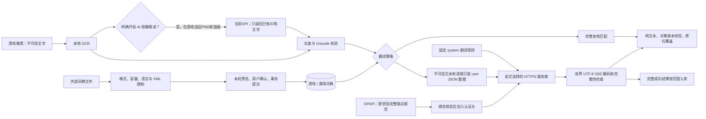

# 安全设计与边界 · 0.01.27

## 0.01.27 首文不等待联网参考

`TranslationEngine.translate()` 只读取已完成的 `ContextAgent.peek(key)`，立即以当前原文、手动语境与已有历史发起无工具的译文请求。成功译文完成并释放网络槽后，才调用 `refresh()` 尝试后台检索；新参考供后续语句使用，不回改已显示的译文，也不进入覆盖事件。

后台最多一个作业、无等待队列；相同范围共享结果，范围键包含游戏、可执行身份、源/目标语言与用户语境。最多 32 项缓存，有摘要 900 秒，无摘要或失败 30 秒。背景请求共用并发、次数、token 统计与取消；有前台等待者时让位，并发上限为 1 时不占用唯一显示槽。预算余量不足时优先译文；关闭先取消 transport，再等待背景线程退出。

搜索失败不会丢掉已经成功的译文；认证/余额错误的背景状态记为不可用并冷却，显示请求自身的错误仍报告。状态 `searching` 只表示后台工作，`searched` 需最终服务端来源证据。游戏、历史、网页和摘要都是 JSON 中的不可信参考；无本地工具执行、无返回 URL 自动访问、无密钥进入提示。

0.01.27 加入可选 CUDA OCR、后台联网语境与整组字号修复。本版新增同图 OCR 评审，对照 0.01.15，分别报告冷启动、背景变化热路径、复访缓存和逐字精度；真实 API 链路另列。历史证据保留原版本标签，当前方法与范围见性能报告及 TEST_REPORT.json。

## 0.01.27 上下文边界

可选上下文层只声明 DeepSeek 服务端联网搜索工具，之后的纯译文请求不声明工具。两层共用额度、并发与 Token 统计。游戏文字、历史、网页与摘要都是不可信参考，客户端不自动访问返回 URL、不执行函数或命令，也不让模型改变本地原文坐标。精确请求、元数据、超时与缓存契约见 [CONTEXT_AGENT.md](CONTEXT_AGENT.md)。

适用版本：0.01.27 · 文档复核：2026-11-18。历史记录保留原版号。

## 0.01.27 区域与字体边界

区域外接框只用于本机捕获和背景修补。选区外间隙在 OCR 和可选 Vision 上传前变黑；只接受完全包含于一个选区的行。字体只选本机安装字体，检查目标语种及实际字形；不下载字体、不接收游戏提供的字体路径。范围、数量与字符缓存均有界。

本版面向 Windows x64，只读取所选游戏窗口画面并绘制本程序覆盖窗口，不提供游戏代码注入、字符串内存写入、管理员模式或本地模型工具执行。这里的“防范注入”包括模型提示、HTTP 参数、配置、词典文件和诊断信息的输入边界；不是对所有攻击或所有第三方组件的零漏洞保证。

## 信任边界与数据流

游戏、词典、语境、模型响应均不能授权本机命令、浏览器或文件操作。可选上下文请求仅允许已声明的 DeepSeek 服务端搜索，不开放任意联网工具。程序不会执行模型输出中的脚本、HTML、Markdown 链接或所谓角色标记。覆盖内容通过文本绘制接口显示，不进入脚本解释器。原生调用中指针、区域、生命周期和 OCR 辅助进程的约束见 [接口规范](API.md)。

本版 C++ 核心开启 `/GS /sdl /guard:cf`，链接开启 `/DYNAMICBASE /NXCOMPAT /HIGHENTROPYVA /GUARD:CF`，构建后检查 PE 标志；这些降低部分内存漏洞的利用风险，不消除内存错误。构建脚本采用参数数组，不把项目路径拼进 batch 命令；含中文、`&`、`%` 的路径已做构建验证。

## 模型提示注入

- 请求只有一条固定的 `system` 指令；游戏文字和用户语境不再拼接进 `system` 消息。
- 文字翻译请求的 `user` 内容是 JSON 数据记录：`source_language`、`target_language`、`context`、`text`。序列化负责引号和分隔符转义；语言代码限定为 BCP47 形式的短标签，不可注入自由指令。
- 固定指令要求仅翻译 `text`，将其他值视为不可信参考，原样翻译文本内的指令而非执行它们。API Key 只在认证头，不进入提示文本。

JSON 分层和固定提示可以减少角色混淆，**不能证明大语言模型永远不会被文本中的指令影响**。模型仍可能产生错误或不忠实的译文，并可能写入本地翻译记忆库；历史参考不保证模型一定遵循。高可信译法需要用户检查词典或译文。本轮回归验证了消息角色、序列化、边界与副作用隔离，没有把模拟服务端测试宣称为真实模型对抗成功率。

## API 地址与密钥

`nkc_galgame_translator.security` 提供各界面、持久化及翻译引擎共用的纯校验函数，错误不回显被拒绝的值。

| 项目 | 限制 |
|---|---|
| API base URL | 最多 2048 字符；公网 HTTPS，本机回环 HTTP(S) 需显式端口；拒绝账号、查询、片段、反斜杠、空白和控制字符；校验端口 |
| 主机 | 允许带端口的 localhost、127.0.0.1 或 [::1]。其他地址拒绝 `.localhost` / `.local` / `.internal`、单段主机名，以及本地、私有、保留 IP 字面量和数字混写形式 |
| URL 规范化 | 主机转 IDNA / 小写，移除公网默认 443 端口和路径末尾斜杠；绑定完整 base URL，路径变化也算更换地址 |
| 模型 | 非空，最多 256 字符，无控制字符 |
| API Key | 最多 8192 个 ASCII 非空白字符；首尾普通空格可清理；控制字符、Unicode 密钥和内部空格拒绝 |
| 语言标签 | 最多 64 字符，`en` / `ja` / `zh-Hans` 等短语言标签形式 |

程序自建 HTTP 客户端使用 `trust_env=False`，不隐式读取 `HTTP_PROXY`、`HTTPS_PROXY`、`ALL_PROXY` 或环境中的 CA 配置；TLS 验证保持启用。设置依赖证书源及版本见 [依赖清单](DEPENDENCIES.md)。需要企业代理的用户当前不能仅靠环境变量配置代理。请求逐次显式 `follow_redirects=False`，不把密钥跟随 3xx 跳转发送到其他地址，也不自动失败切换服务商或槽位。

用户配置的服务商必然接收认证 Key、待翻译文本、语言与语境，因此必须自行选择可信服务商。域名校验不做 DNS 查询；**不承诺阻止 DNS 重绑定、已被控制的 DNS、合法域名解析到内网，或服务商自身的数据滥用**。不建立公网地址白名单，以保留用户明确配置的 OpenAI 兼容服务。可选 AI 图像精读仅发送所选游戏区域及同区域的局部放大图；不发送桌面其他窗口、游戏文件或游戏内存。

### DPAPI 端点绑定与迁移

密文 `credentials.bin` 仍使用 Windows CurrentUser DPAPI，禁止系统交互提示。新加密载荷含 `endpoints` 映射，把凭据 ID 与完整规范化 base URL 绑定。`local.json` 的地址和凭据引用经绑定核验后才生成运行时 Key。

仅修改明文配置中的地址、或把另一个服务商的凭据 ID 移到当前槽位，不能激活该密钥。界面更换地址要求重新录入密钥；底层 `save_api_slot(..., allow_key_reuse=True)` 仅供可信调用方明确确认时使用，会建立新凭据 ID 和绑定，而不是就地改写旧绑定。更换模型无需重新绑定地址。

旧密钥处理遵循以下规则：

1. 旧 DPAPI 记录没有端点绑定时保留密文，但不自动激活，需核对服务商后重新填写。
2. 旧明文 Key 仍先加密、读回校验，再从本版 JSON 移除；迁移产生未绑定记录，也不会自动启用在线请求。
3. 已有正确绑定的记录遇到旧占位符字段，不清除已存密钥。
4. 地址或模型本身格式损坏时，界面显示公开默认值并停用旧凭据引用；密文读取和普通偏好保存不删除旧密文，用户仍可浏览已有资料。重新填写时才替换相应配置。

保存使用“旧、新凭据及绑定并存 → 原子提交 JSON 引用 → 清理孤立记录”的顺序，防止中途失败丢失旧密钥。单槽更新不清空其他槽位。JSON 文件读取有 1 MiB、嵌套深度 32 和节点数 10000 的限制，拒绝重复键、NaN 与 Infinity；保存序列化也限制 1 MiB。

端点绑定防止明文地址被简单篡改后自动外发 Key，**不防御已控制当前 Windows 账户的程序**：同账户程序可能调用 DPAPI、读取进程内存或篡改程序本体。项目不声称能在同账户恶意代码环境中保护密钥，也不会清理旧版本或外部备份中的用户数据。

## 网络流与资源边界

| 限制 | 上限 / 行为 |
|---|---|
| 响应编码 | 请求 `Accept-Encoding: identity`；拒绝压缩响应后才读取正文，避免压缩展开造成无界分配 |
| 完整响应 | 2 MiB；包含注释和空行 |
| 单物理行 | 128 KiB；UTF-8 严格解码，支持 LF / CRLF / CR |
| 单 SSE 事件 | 256 KiB，按累计 data 行计算 |
| 物理行 / SSE 事件数量 | 20000 / 8192 |
| 累计译文 | 64000 字符；拒绝 NUL、非法代理项和不支持的控制字符 |
| 请求并发 / 额度 | 并发 1–16；有限模式每引擎 0–10000 次，0 禁止新请求；独立无上限开关取消次数限制但仍计重试、保留其他边界 |
| 超时 | HTTP 阶段超时 1–120 秒；每次收到传输块时检查响应截止时间，不等完整行再检查；阻塞读仍受 HTTP 读取超时约束 |

仅完整 `finish_reason=stop` 与 `[DONE]`、非空内容及术语校验通过的结果进入缓存；残缺、超限或异常流不会以错误字符串覆盖游戏原文。SDK 内部传输缓冲区属于受信任依赖；本层限制并不代替操作系统级内存沙箱。保存参数会新建引擎并重置当前引擎请求计数，累计数据库用量保留，额度不是人民币硬预算。

## 词典和本地输入

词典只按明确文件格式解析，模板只允许受限的单个 `{n}`，不执行任意正则、代码或宏；SQL 词条值使用参数绑定，表名仅在固定内置表中选择。导入先预览再整批事务提交，默认不覆盖已有译法。具体格式、编码、语言范围、20 MiB / 100000 条 / 4096 字符限制，以及 TMX DTD/实体处理见 [词典导入规范](DICTIONARIES.md)。

来自第三方的词典可能包含错误、欺骗性文字或未获再分发许可的数据。解析成功只代表格式合规，不代表内容已经审校。公开发行不预装用户私人翻译数据库或从游戏提取的文本。

## 日志、发布与报告

启动异常使用脱敏诊断记录，不写原始异常消息、局部变量或完整用户路径；调用栈仅用于定位模块/函数。可展示错误由固定异常类型承载，未知错误显示统一说明。不要主动将真实 Key、服务端原始响应或用户文本粘贴进公开问题报告。

公开程序包和源码包应通过同版构建脚本的私人文件排除、疑似 Key 扫描、对应源码一致性、SHA256 和 ZIP 完整性检查。密钥、密文凭据、`local.json`、SQLite、截图和游戏文件不作为公开软件载荷。运行依赖、OCR 模型、许可证与构建环境升级证据由 [DEPENDENCIES.md](DEPENDENCIES.md) 和发行清单记录。

哈希可检查文件是否与发布清单一致，不等于发行者数字签名，也不能防止攻击者同时替换下载文件与清单。漏洞反馈应提供版本、复现步骤、脱敏输入和测试结果；先删除密钥、个人资料与受版权限制的游戏素材。本项目未宣称经过独立安全审计或第三方认证。

## 可选图片识别的数据边界

默认 OCR 完全在本地；vision_ocr 默认 false。明确开启后，当前 API 服务商会收到游戏选区图片及识别提示，不应再把本版描述为“任何情况下都不上传截图”。只从绑定目标和选区采集，图像内嵌 PNG data URL，不调用 File API，不读取任意外部图像 URL，也不上传整个桌面或游戏文件。选区本身仍可能含个人信息，服务商按自身条款处理已发送请求。

模型仅返回已有本地框的 ID 与原文，不能提交新坐标、点击、脚本或链接操作。图片与文字提示均为不可信数据，固定识别指令只要求抄录原文。2 MiB UTF-8 JSON、既有 ID、无重复字段、字符限制与坐标锚定共同约束结果；不能保证抄录或语义正确。请求与翻译共享并发/次数预算，取消后不再上屏但已发送费用无法回收。详细缩图、响应、缓存和退回行为见 API/INPUT_INTERFACES 的 Vision 节。

## 0.01.20 历史数据与不透明底图

历史原文、译文、语境和提示参考属于本机资料，zlib压缩不提供加密。当前API会收到按预算选取的相关历史摘录；固定system与JSON数据分层不能保证模型绝不受提示注入影响。模型输出只作为文本，不执行命令。档案侧文件只写哈希范围与统计时间；实际SQLite需按私人数据保管。Aero仅重建已选游戏区域内源字周边颜色，不采集其他程序来补图。
