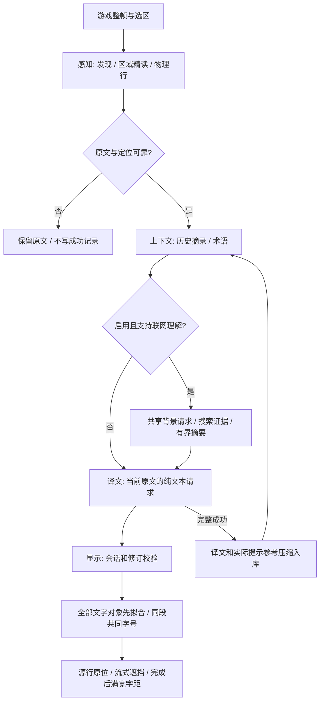
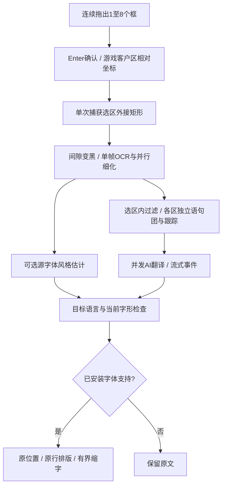
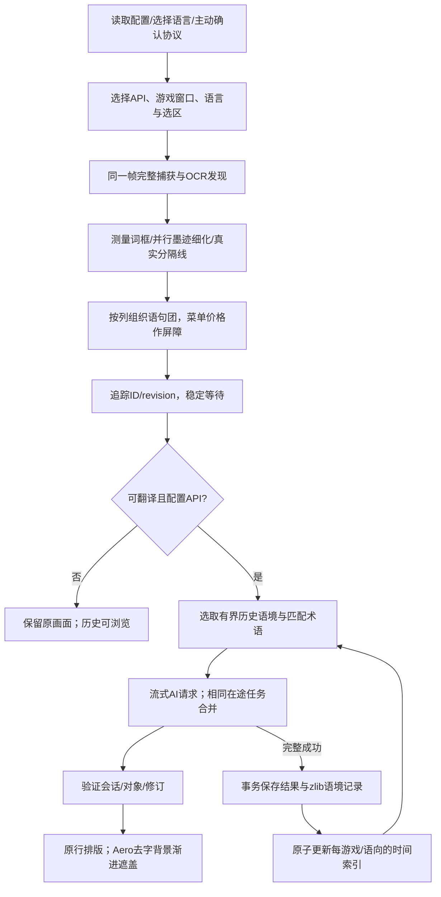
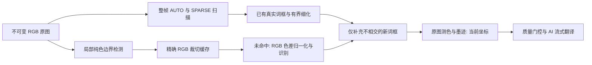

# 工作流程 · 0.01.27

## 0.01.27 首文不等待联网参考

`TranslationEngine.translate()` 只读取已完成的 `ContextAgent.peek(key)`，立即以当前原文、手动语境与已有历史发起无工具的译文请求。成功译文完成并释放网络槽后，才调用 `refresh()` 尝试后台检索；新参考供后续语句使用，不回改已显示的译文，也不进入覆盖事件。

后台最多一个作业、无等待队列；相同范围共享结果，范围键包含游戏、可执行身份、源/目标语言与用户语境。最多 32 项缓存，有摘要 900 秒，无摘要或失败 30 秒。背景请求共用并发、次数、token 统计与取消；有前台等待者时让位，并发上限为 1 时不占用唯一显示槽。预算余量不足时优先译文；关闭先取消 transport，再等待背景线程退出。

搜索失败不会丢掉已经成功的译文；认证/余额错误的背景状态记为不可用并冷却，显示请求自身的错误仍报告。状态 `searching` 只表示后台工作，`searched` 需最终服务端来源证据。游戏、历史、网页和摘要都是 JSON 中的不可信参考；无本地工具执行、无返回 URL 自动访问、无密钥进入提示。

## 0.01.27 整组拟合与短续行

同一段正文以源行墨迹高度的中位数作稳定参考。至少三行且有至少两条宽正文、宽正文占多数时，极短续行或明显低墨迹行不单独把整组压成极小字号。单个 Region 内，短续行溢出可尝试把完整字簇分配到紧邻前行已测得的空余宽度，最多检查 64 个候选且续行至少保留一簇；行框不扩大。不能容纳的弱证据行保留原文字像素。跨 Region 不挪动文字；普通、中宽长译文仍约束共同字号。

流式阶段显示当前参考字号能容纳的前缀，完整译文仍累计保存；完成后再执行整组拟合和满宽字距。标题、列、源字号/风格、固定字号与显式字号上限边界保留。少数弱框可能仍显示原文，流式尾部可能等到 final 后出现。这是显示修复，不代表 OCR 或语义翻译准确率提高。

不新增用户配置，不改变 ABI 2 或原有导出签名；原生诊断新增 `font_intrinsic_px` 与 `lines[].drawable`。`fits=true` 表示可靠约束行已拟合，弱异常行仍可能 `drawable=false`，逐行可见性应检查该字段。本版 C++ 核心需要重新编译与验收，旧版 native audit 不构成本版二进制证据。

## 0.01.27 窗口身份与运行状态

`window_metadata(hwnd, paths=None)` 返回 `hwnd,pid,title,process_path,exe_name,class_name`；刷新列表时按 PID 共享进程路径查询。`translation_target(row)` 是基于元数据的目标筛选，不按游戏名或引擎白名单判断。资源管理器、桌面、任务栏、系统辅助进程/窗口类及本程序覆盖层不作为候选。列表显示“标题 · 可执行文件名 · PID”。

`App.chosen_window()` 选择时重新读取元数据并检查 HWND/PID，拒绝过期身份和系统辅助窗口。`window_state(hwnd, expected_pid)` 返回 `closed / replaced / minimized / hidden / background / active`；此查询不打开进程。`App._refresh_running_status()` 最多每秒刷新一次，结合目标状态和管线事件区分等待、识别、未找到文字、AI 请求与已显示译文；实际错误保持锁存直到停止或重启。状态文本不是翻译完成证据：后台、最小化或不可见选区不会继续截图翻译。源/目标语言、1–8 选区、截图选项、字体与字距行为不变。

0.01.27 加入可选 CUDA OCR、后台联网语境与整组字号修复。本版新增同图 OCR 评审，对照 0.01.15，分别报告冷启动、背景变化热路径、复访缓存和逐字精度；真实 API 链路另列。历史证据保留原版本标签，当前方法与范围见性能报告及 TEST_REPORT.json。

## 质量优先的四层流程

联网理解的搜索来源与摘要是参考数据，不属于译文流，不进入游戏覆盖。上下文失败时可使用已有历史直接翻译；认证、余额和权限错误保留可见诊断。联网请求、稳定等待、OCR、首段译文和完整译文分别计时，不能把 OCR 微基准当成总延迟。具体状态、额度与取消契约见 [CONTEXT_AGENT.md](CONTEXT_AGENT.md)。

适用版本：0.01.27 · 文档复核：2026-11-18。历史记录保留原版号。

## 多区域工作流

AI 图像精读也只接收选区像素与黑色间隙，取消或改变选区会使未完成结果失效。每框使用自己的字体风格；流式输出沿用原文字体拟合规则，移动仍由原生窗口锚点跟随。

质量门控、数字/按键/HUD无意义判断仍在 AI 请求之前；可疑 OCR 不作为译文重画，也不进入成功档案。正常专名不会仅因词典没有就跳过。译文与原文仅大小写或空白不同则不额外盖一层标签。

全帧定位后，可靠平坦边缘才支持墨迹收紧；不确定复杂纹理保留原测量。真实分隔线通过本地枚举证据传递，外部 JSON 同名标记不可信。多列正文按非相交列链组织，短结束句后的新宽句可分团；语句团不是任意拼接邻近文本。每团保留 `_source_rows`，原行数不变。

API 失败/取消/超时/截断不写成功档案。上下文选择在请求前锁内完成，请求期间不锁数据库；成功响应与压缩事件在同一事务提交，再更新 `updated.json`。索引更新失败计入诊断，数据库内已提交记录仍有效。

更新使用独立版本目录；旧目录保持可回退。档案目录名为范围哈希而非游戏原文字，避免路径注入；最新时间存入带时区 JSON。不会因每次翻译而改名正在运行的目录，也不自动联网下载安装新版本。

## 0.01.23 混合颜色识别流程

同一帧含多个不同背景时分别归一化。整帧原结果保留，缓存不拥有绝对位置。没有把画面预先任意切成线程碎片。
