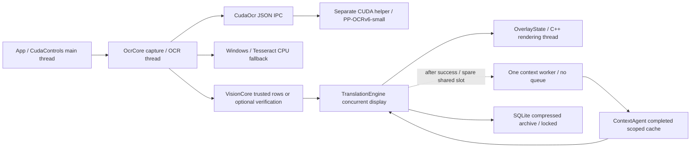
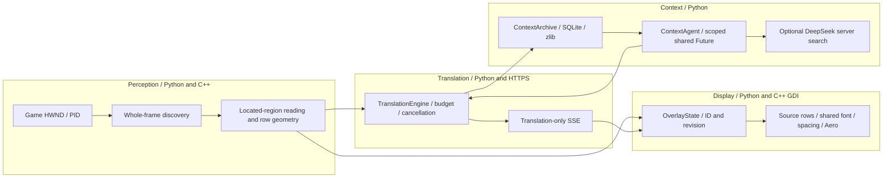
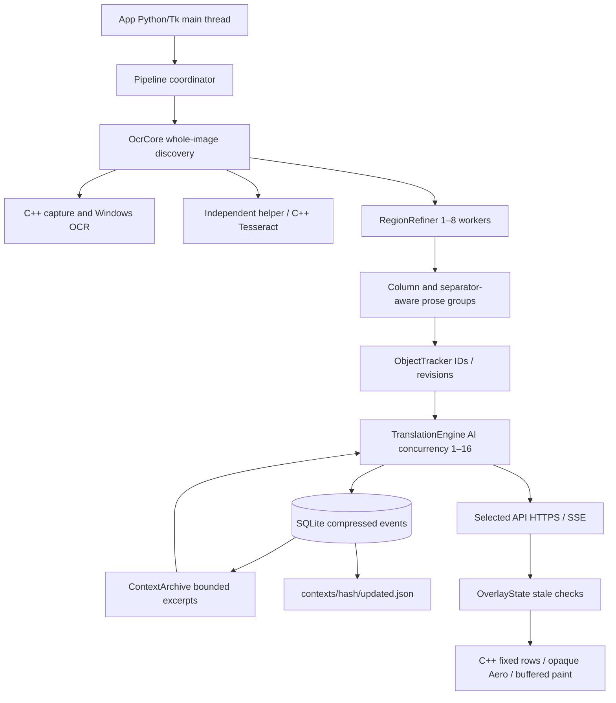

# Architecture, languages and threads · 0.01.27

## 0.01.27 Runtime structure



The CUDA helper is separate from the GUI. Background context uses at most one thread and shared network capacity, never a search process per text box. Display receives only translations and local geometry.

## 0.01.27 CUDA modules and IPC

| Module / class | Language | Responsibility |
|---|---|---|
| `cuda_ocr.py` / `CudaOcr` | Python / MIT | Local bounded JSON IPC client, hidden helper, image paths and lifecycle; no deep-learning imports in the GUI |
| `tools/cuda_ocr_helper.py` / `Engine` | Separate Python helper | RapidOCR / ONNX Runtime CUDA, PP-OCRv6-small detection/recognition, verification of executed CUDA kernels |
| `cuda_settings_ui.py` / `CudaControls` | Python / Tk | Shared first-run/settings switch, linear quality slider and memory budget; no probing/downloads |
| `OcrCore` | Python | Attempt GPU in Auto for en/ja/zh; same-frame CPU fallback on failure, actual `cuda_status` |

`CudaOcr(root, memory_mb=1024, quality=75)` exposes `available()` (files only), serialized `recognize(image, language='en')` and `close()` (helper/temp-image cleanup). Recognition requests contain only `image_path/language`; `warmup()` sends `{"warmup":true}` using synthetic tensors without capture/network; `cancel()` interrupts the helper and the cancelled instance cannot restart. Images are restricted to the allowed temporary root; stdin is data, never code. Responses contain `lines/ocr_ms/cuda`, at most 512 rows, 64000 total text characters and 1 MiB response size; rectangles must fit the image and confidence must be finite in 0–100. Acceptance requires `CUDAExecutionProvider` and `kernels_verified=true`, rather than provider availability alone.

States: `disabled/ready/active/not_installed/failed/cpu_mode/pixel_priority/unsupported_language`; ready is not proof of completed inference. Versions and hashes are locked in `requirements-cuda.lock`, `CUDA_DEPENDENCY_MANIFEST.json` and `models/cuda/manifest.json`. Distribution manifests carry component/model licensing. Installation/verification failure must preserve CPU fallback rather than claiming GPU acceleration.

## 0.01.27 Display does not wait for web reference

`TranslationEngine.translate()` reads only completed `ContextAgent.peek(key)` reference and immediately sends a tool-free translation request using current source, supplied context and available history. Only after successful translation and network-slot release does `refresh()` attempt background research. New notes benefit later sentences, never revise an already displayed translation or enter overlay events.

At most one background task and no waiting queue. The key includes game, executable identity, source/target languages and supplied context; 32 cached entries, 900 seconds with a summary and 30 seconds for empty/failed references. Background work shares concurrency, request/token accounting and cancellation, yields to waiting display jobs and does not use the sole slot when concurrency is one. Remaining budget favors translation. Closing cancels transport and joins the background worker.

Research failure cannot discard successful output. Background authentication/balance errors become unavailable with cooldown; errors in display requests still surface normally. `searching` denotes background work; `searched` requires final server-source evidence. Source/history/pages/notes remain untrusted JSON data: no local tools, automatic returned-URL fetches or credentials in prompts.

## 0.01.27 Group fitting and short continuation rows

Continuous body text uses median source-row ink height as a stable reference. In a group of at least three rows with at least two wide body rows forming a majority, a very short continuation or unusually shallow ink row does not alone shrink the whole paragraph. Within one region, overflowing continuation text can move complete clusters into measured spare width on the immediately preceding row: at most 64 candidates, retaining at least one cluster on the continuation. No row rectangle expands. A weak row that still cannot fit preserves original pixels. Text never transfers between regions; ordinary/medium-width long translations still constrain the shared font size.

Streaming paints the prefix fitting the current reference size while retaining cumulative full text; final output triggers group fitting and full-width spacing. Heading, column, source-style/size, fixed-size and explicit-cap boundaries remain. Some weak boxes can retain untranslated source, and a stream tail can wait for final output. This is a rendering fix, not an OCR or semantic-accuracy claim.

No new setting or ABI 2/export-signature change. Native diagnostics add `font_intrinsic_px` and `lines[].drawable`. `fits=true` means reliable constraint rows fit; a weak outlier can still have `drawable=false`, so inspect per-row visibility. This version's C++ core requires a new build/audit; the old native audit does not certify its binary.

## 0.01.27 window identity and runtime status

`window_metadata(hwnd, paths=None)` returns `hwnd,pid,title,process_path,exe_name,class_name`; list refresh shares process-path queries by PID. `translation_target(row)` filters metadata, without a game-title/engine allowlist. Explorer, desktop, taskbar, shell/helper windows and the application's overlay are excluded. Entries display “title · executable · PID”.

`App.chosen_window()` rereads metadata and validates HWND/PID, rejecting stale identities and shell/helper targets. `window_state(hwnd, expected_pid)` returns `closed / replaced / minimized / hidden / background / active`, without opening the process. `App._refresh_running_status()` runs at most once per second and combines target state with pipeline events to distinguish waiting, recognition, no text, AI requests and displayed translations. Actual errors stay latched until stopping/restarting. A status label is not evidence of completed translation: background/minimized targets and invisible selections are not captured for translation. Language settings, 1–8 selections, screenshot options, fonts and character spacing remain unchanged.


Version 0.01.27 adds optional CUDA OCR, background context and group font fitting. Fresh same-image OCR evidence compares 0.01.15 with 0.01.27, separating cold startup, changed-background warm paths, cached revisits and character accuracy; real-API observations are separate. Historical evidence retains its original version labels. See the current performance and test reports for scope.

## 0.01.27 harness layers and ownership



`nkc_galgame_translator/context_agent.py` manages bounded background requests, not arbitrary model tool execution. `ContextAgent.peek/refresh` reads available notes and refreshes after successful display; internal `resolve` shares in-flight Futures by game identity, language pair and supplied context, with at most 32 entries. Summaries live for 900 seconds; failures and empty summaries cool down for 30 seconds. Search and translation share engine concurrency and accounting. See [CONTEXT_AGENT.md](CONTEXT_AGENT.md).

`fixed_layout.h` anchors size to a fixed representative alphabet rather than the current token's ink height. At final completion, the native thread jointly fits compatible body peers; ordinary long rows constrain the group while qualifying weak continuations do not alone shrink it. Streaming first paints a fitting prefix. This display association does not merge text, requests, source rectangles or selections. `font_peers` reports the number of jointly sized regions, default 1. Headings, different source sizes/styles/explicit caps, columns and larger paragraph gaps remain independent.

Compatibility review: 0.01.27 · 18 November2026. Historical sections retain their original version numbers.

## Selection and source-font modules

```text
nkc_galgame_translator/selection_regions.py  Python: immutable plans, clipping, masks, group boundaries
nkc_galgame_translator/font_style.py         Python/Pillow: SourceStyleMatcher, TargetFontSelector
nkc_galgame_translator/app.py                Python/Tk: repeated selection, confirm/undo, window identity
nkc_galgame_translator/ocr.py, vision_core.py Python: one masked frame, scope filtering, source style
nkc_galgame_translator/pipeline.py, tracking.py Python: selection isolation and concurrent translation
native/core.cpp, core.h          C++17/GDI: coverage checks and per-box font export
native/fixed_layout.h            C++17/GDI: consistent measurement and fixed-row drawing
```

All rectangles share one capture worker, the existing OCR helper and bounded refinement pool. No per-selection OCR processes or extra worker pools are created. Source style analysis runs in the OCR worker; target font choice occurs on the display path and native painting remains on its own thread. Style and coverage caches each hold at most256 entries. Frame cache identity includes selection scope and the automatic-style flag.



## Source map

| Source / class | Language | Responsibility |
|---|---|---|
| `main.py`, `App` | Python/Tk | Entry, five pages, target/profile selection; widgets remain on main thread |
| `SettingsPanel`, `tuning.py` | Python | Bounded numeric/boolean settings and appearance |
| `ApiSettingsDialog`, `ConfigStore` | Python/Win32 | Three API slots, CurrentUser DPAPI, atomic config |
| `Pipeline` | Python | One capture thread, one coordinator, latest-only queue of size 1; up to 32 tracks |
| `OcrCore`, `PortableOcr` | Python | Whole-image discovery; independent OCR helper process |
| `RegionRefiner` in `ocr_regions.py` | Python/Pillow | 1–8 workers, default 4; up to 512 regions and a 4-million-pixel work budget |
| `layout.py` | Python | Column reading order, prose groups, barriers and physical source rows |
| `ObjectTracker` | Python | 1–4 matching workers; stable identities/revisions; GIL limits CPU scaling |
| `TranslationEngine` | Python/httpx | AI-only output, 1–16 network requests, in-flight duplicate sharing |
| `ContextArchive` | Python/SQLite/zlib | Serialized DB access under engine lock, compressed events, bounded reference context and atomic index |
| `ContextAgent`, `ContextReference` | Python/httpx | Scoped shared research, server search evidence and bounded notes/sources; no layout or local-operation authority |
| `OverlayState` | Python | Session/track/revision checks and atomic geometry confirmation |
| `NativeCore` | Python/ctypes | ABI bridge, argument/lifetime validation |
| `Context`, `OverlayWindow` | C++17/WinRT/GDI | Frame capture, Windows OCR, independent overlay thread, double buffering |
| `fixed_layout.h` | C++ | Source rows, ink-calibrated font, spacing and shrink-to-fit |
| `aero_background.h` | C++ | Glyph-mask local repair; preserve non-glyph RGB |
| `vision.py`, `VisionCore` | Python | Optional image reading anchored to local geometry |
| `dictionary_import.py` | Python | Historical term imports as reference data |

`expert.py` is removed. No additional dependency is required. AI-only describes translation generation; OCR and image geometry still execute locally.

## Data and ownership

`data/codebook.sqlite3` retains dictionaries/translations and adds `ai_context_events`. `data/contexts/<scope_id>/updated.json` is an automatically refreshed index, not the record store. `config/credentials.bin` contains account-bound DPAPI data; `local.json` contains preferences and credential references. Private data is excluded from public archives.

Immutable background frames have their own lock. The overlay thread does not wait for long OCR calls. Textures are cached by captured frame and source geometry, bounded to 64MiB per overlay snapshot. Separate capture, OCR, refinement, matching and network work do not imply linear CPU scaling or perfect recognition.

## Window movement contract

`gl_overlay_anchored(context, regions, count, rows, row_count, offsets, origins)` is an additive ABI 2 export. The first six arguments follow `gl_overlay_fixed`; `origins` contains `2*count` int32 capture-origin coordinates. NativeCore validates each region's `_capture_origin` and uses this entry when all regions supply it. Coordinates never come from model output.

Submission converts absolute OCR coordinates into game-client-relative positions. A native 16 ms timer moves overlay HWNDs without OCR, translation, refitting or activation. Late tokens with old capture origins remain at the current window position. The timer interval is not a scheduling-latency guarantee. Background sampling rebases into its source frame's client origin. Resize hides old geometry until fresh layout; focus loss, minimization and out-of-bounds placements hide overlays.

Transient capture movement, resizing or an unavailable first frame returns `changed:false,pending:true,lines:[]`. OcrCore/VisionCore forward this status; Pipeline retries without confirming stale rows or submitting translation. Nonrecoverable errors still stop capture and report failure.

## Added in 0.01.22

`nkc_galgame_translator/frame_cache.py`: Python FrameCache, a bounded 16-entry / 128 MiB accounted whole-image OCR LRU. OcrCore owns synchronization and current placement. TranslationEngine shares in-flight partials; the native DLL is unchanged.

## 0.01.23 color recognition modules

`tools/ocr_helper.py` (independent MIT Python/Pillow) owns RGB contrast and ContrastCache. Tesseract (C++) reads glyphs and word geometry. `nkc_galgame_translator/ocr.py` (Python) extends flat-color auto routing and samples original colors/ink. The native capture/overlay DLL is unchanged. No added dependencies or threads.
