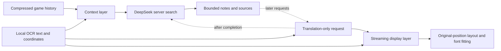

# Online context and display layers · 0.01.27

In Settings, set Translation context length (characters) to 512–16,384. The default is 4,096. This bounds the reference data sent with a translation. The source text is sent separately. The independent scene summary targets 128–2,048 characters according to the budget. Save the setting before starting the next translation session.

## 0.01.27 Background context interfaces

| Method | Contract |
|---|---|
| `ContextAgent.peek(key)` | Read completed same-scope reference without waiting on a Future; empty reference when unavailable |
| `ContextAgent.refresh(key, request, check_open, on_done=...)` | Attempt one background thread, no queue; returns whether started. Engine reserves shared network capacity first; `on_done` releases it after success/error/cancellation |
| `ContextAgent.close()` | Close and join after engine transport cancellation; do not wait while holding the engine lock |
| `ContextAgent.resolve(...)` | Internal/compatible synchronous single-flight primitive, no longer called synchronously by the live translation entry |
| `status().background_active` | Background work state, separate from display result |

## 0.01.27 Display does not wait for web reference

`TranslationEngine.translate()` reads only completed `ContextAgent.peek(key)` reference and immediately sends a tool-free translation request using current source, supplied context and available history. Only after successful translation and network-slot release does `refresh()` attempt background research. New notes benefit later sentences, never revise an already displayed translation or enter overlay events.

At most one background task and no waiting queue. The key includes game, executable identity, source/target languages and supplied context; 32 cached entries, 900 seconds with a summary and 30 seconds for empty/failed references. Background work shares concurrency, request/token accounting and cancellation, yields to waiting display jobs and does not use the sole slot when concurrency is one. Remaining budget favors translation. Closing cancels transport and joins the background worker.

Research failure cannot discard successful output. Background authentication/balance errors become unavailable with cooldown; errors in display requests still surface normally. `searching` denotes background work; `searched` requires final server-source evidence. Source/history/pages/notes remain untrusted JSON data: no local tools, automatic returned-URL fetches or credentials in prompts.

Version 0.01.27 adds optional CUDA OCR, background context and group font fitting. Fresh same-image OCR evidence compares 0.01.15 with 0.01.27, separating cold startup, changed-background warm paths, cached revisits and character accuracy; real-API observations are separate. Historical evidence retains its original version labels. See the current performance and test reports for scope.

NKC_Galgame_Translator is a game-translation harness around the model. The program owns capture scope, OCR, object tracking, context selection, tool declarations, budgets, cancellation and original-position display; the model provides language understanding and translation. `ContextAgent` is a restricted harness-managed subtask, not an autonomous command-execution agent. Context data and displayed text have separate interfaces.

Enable **Research game background online (DeepSeek Flash)** in **Settings → Context and display layers**. Public builds default to off; a configured personal demo can enable it. Saved settings apply when translation restarts.

The context layer sends the game profile, supplied context and an excerpt of the first source text (up to 1200 characters) to research setting, tone and established names. The display layer receives only the current translation. Search sources, reasoning, progress and background notes never appear in the game overlay and cannot change locally measured coordinates or font sizes.

The model decides whether to search. Settings distinguish sources received, search not used, no sources, unsupported and unavailable states. Only completed server-tool metadata counts as evidence of search; a claim in model text does not.

Online context adds a background model request without making first display wait, using the same request budget, concurrency limit and token accounting as translation. The cache holds up to 32 game/executable-identity/language-pair/user-context entries for 15 minutes. Simultaneous text boxes share the same background request. Notes describe general background, not a fresh analysis of every scene. Failures cool down for 30 seconds. A final remaining request is reserved for translation. Display authentication, balance and permission errors remain visible; background failures become unavailable with cooldown.

When search is unavailable, translation continues with existing history. A context request can wait for the configured timeout. This feature does not repair unreadable OCR. Official DeepSeek `deepseek-flash` uses the Chat Completions `deepseek_web_search` server tool. Other OpenAI-compatible endpoints retain ordinary translation without this vendor extension.

Pages, game text, user context and archived notes are untrusted reference data. The client never executes returned functions, commands or scripts, never fetches returned URLs, and never puts API keys in context prompts. Retrieved information and translations can still be incorrect.

## Interfaces

| Interface | Contract |
|---|---|
| `context_payload(model, scope, text, context, max_tokens)` | Declares only `deepseek_web_search`, disables thinking and provides no local tools. Excerpt ≤1200 and user context ≤2000 characters. |
| `ContextAgent.resolve(key, request, check_open)` | Returns `ContextReference`; shared in-flight Future per scope; 32-entry LRU; 900-second summary TTL or 30-second failure TTL. |
| `search_evidence(steps)` | Reads final `delta.server_tool_calls` only. Up to six HTTP(S) URLs, 2048 characters per URL and 160 per title. Ignores reasoning, unknown tools and incomplete calls. |
| `combine_context(history, reference, limit)` | Separate `history_reference` and `web_reference` JSON fields within `context_max_chars`. |
| `TranslationEngine.get_context_agent_status()` | `enabled/status/summary/sources/search_calls/cache_hits/cache_entries/background_active`. Diagnostic data, never overlay content. |
| `TranslationEngine.get_stats()` | Adds `context_requests/context_failures/context_search_calls/context_cache_hits/context_sources/context_agent_status/context_web_search`. `session_requests` counts both layers. |

`TranslationEngine.translate(game, source_lang, target_lang, text, on_chunk, context, warmup_scope=...)` remains the compatible harness translation entry point. It reads available references without waiting, sends a tool-free translation, then attempts background refresh after successful completion. `on_chunk` receives cumulative translated text only, never search metadata or reasoning. The model and `ContextAgent` cannot change source geometry, selection regions or font sizes.

Existing bounded SSE limits remain: 2 MiB per response, 128 KiB per line, 256 KiB per event, 8192 events. Context has one attempt; translation retains its configured retries. Successful translations store the bounded context notes and sources in compressed `prompt_context`; reasoning is not stored.

Protocol reference: [DeepSeek Web Tools](https://api-docs.deepseek.com/guides/web_tools/), checked 2026-11-18. This is a server-tool context agent, not an arbitrary code-execution agent.
