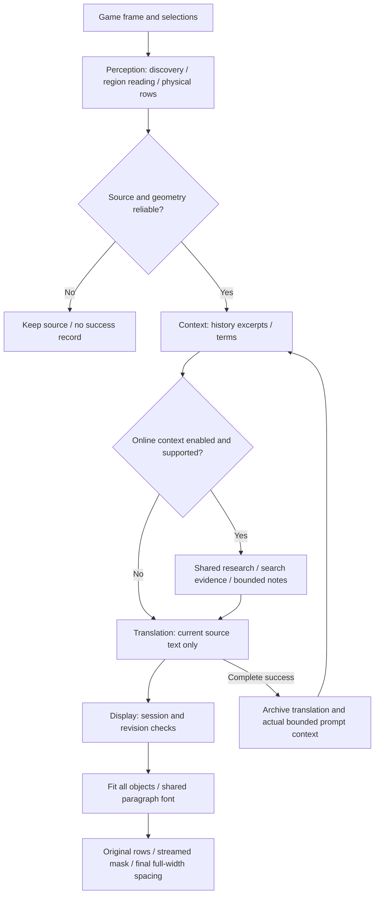
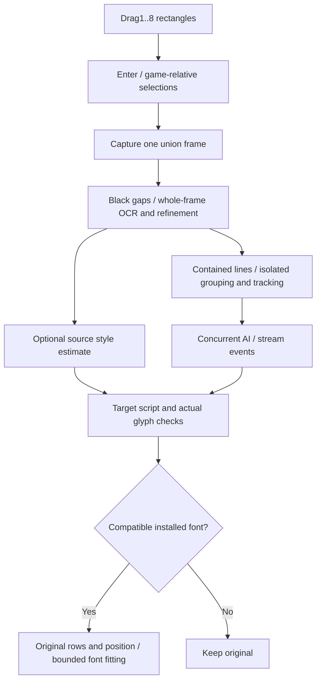
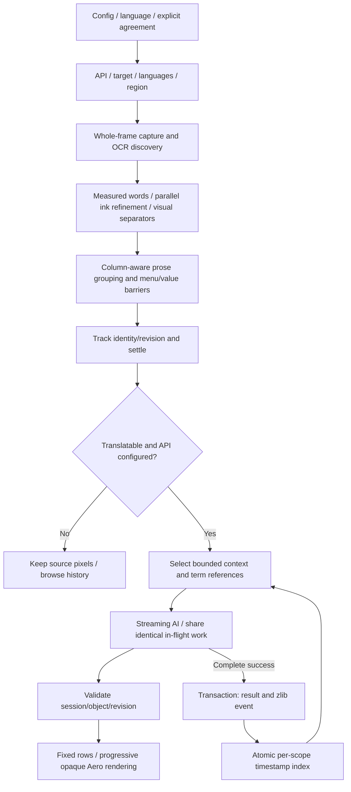

# Workflows · 0.01.27

## 0.01.27 Display does not wait for web reference

`TranslationEngine.translate()` reads only completed `ContextAgent.peek(key)` reference and immediately sends a tool-free translation request using current source, supplied context and available history. Only after successful translation and network-slot release does `refresh()` attempt background research. New notes benefit later sentences, never revise an already displayed translation or enter overlay events.

At most one background task and no waiting queue. The key includes game, executable identity, source/target languages and supplied context; 32 cached entries, 900 seconds with a summary and 30 seconds for empty/failed references. Background work shares concurrency, request/token accounting and cancellation, yields to waiting display jobs and does not use the sole slot when concurrency is one. Remaining budget favors translation. Closing cancels transport and joins the background worker.

Research failure cannot discard successful output. Background authentication/balance errors become unavailable with cooldown; errors in display requests still surface normally. `searching` denotes background work; `searched` requires final server-source evidence. Source/history/pages/notes remain untrusted JSON data: no local tools, automatic returned-URL fetches or credentials in prompts.

## 0.01.27 Group fitting and short continuation rows

Continuous body text uses median source-row ink height as a stable reference. In a group of at least three rows with at least two wide body rows forming a majority, a very short continuation or unusually shallow ink row does not alone shrink the whole paragraph. Within one region, overflowing continuation text can move complete clusters into measured spare width on the immediately preceding row: at most 64 candidates, retaining at least one cluster on the continuation. No row rectangle expands. A weak row that still cannot fit preserves original pixels. Text never transfers between regions; ordinary/medium-width long translations still constrain the shared font size.

Streaming paints the prefix fitting the current reference size while retaining cumulative full text; final output triggers group fitting and full-width spacing. Heading, column, source-style/size, fixed-size and explicit-cap boundaries remain. Some weak boxes can retain untranslated source, and a stream tail can wait for final output. This is a rendering fix, not an OCR or semantic-accuracy claim.

No new setting or ABI 2/export-signature change. Native diagnostics add `font_intrinsic_px` and `lines[].drawable`. `fits=true` means reliable constraint rows fit; a weak outlier can still have `drawable=false`, so inspect per-row visibility. This version's C++ core requires a new build/audit; the old native audit does not certify its binary.

## 0.01.27 window identity and runtime status

`window_metadata(hwnd, paths=None)` returns `hwnd,pid,title,process_path,exe_name,class_name`; list refresh shares process-path queries by PID. `translation_target(row)` filters metadata, without a game-title/engine allowlist. Explorer, desktop, taskbar, shell/helper windows and the application's overlay are excluded. Entries display “title · executable · PID”.

`App.chosen_window()` rereads metadata and validates HWND/PID, rejecting stale identities and shell/helper targets. `window_state(hwnd, expected_pid)` returns `closed / replaced / minimized / hidden / background / active`, without opening the process. `App._refresh_running_status()` runs at most once per second and combines target state with pipeline events to distinguish waiting, recognition, no text, AI requests and displayed translations. Actual errors stay latched until stopping/restarting. A status label is not evidence of completed translation: background/minimized targets and invisible selections are not captured for translation. Language settings, 1–8 selections, screenshot options, fonts and character spacing remain unchanged.

Version 0.01.27 adds optional CUDA OCR, background context and group font fitting. Fresh same-image OCR evidence compares 0.01.15 with 0.01.27, separating cold startup, changed-background warm paths, cached revisits and character accuracy; real-API observations are separate. Historical evidence retains its original version labels. See the current performance and test reports for scope.

## Quality-first four-layer flow

Search sources and summaries are reference data, not translation chunks, and never enter the game overlay. Unavailable research can fall back to ordinary translation with history; authentication, balance and permission errors remain visible. Measure research, settling, OCR, first visible text and complete translation separately; an OCR microbenchmark is not end-to-end latency. See [CONTEXT_AGENT.md](CONTEXT_AGENT.md).

Compatibility review: 0.01.27 · 18 November2026. Historical sections retain their original version numbers.

## Multi-region workflow

Optional AI image reading receives selected pixels with black gaps. Scope changes invalidate pending recognition. Per-box style does not change anchored movement or fixed-source-row layout.

Quality and low-value HUD gates precede requests. Suspect OCR is neither redrawn nor archived as a success. Proper names are not rejected merely for being absent from a dictionary. Output equivalent to the source is not covered with extra labels.

Refinement tightens ink only with reliable flat-edge evidence; uncertain complex textures retain measured bounds. Visual separator evidence is an internal enum, not a trusted JSON flag. Non-overlapping column chains group prose, while short endings/new wide lines can split groups. Every group retains physical `_source_rows`; grouping does not add display rows.

Failure, cancellation, timeout and truncation are not successful archive events. Reference selection is under the engine lock; network I/O does not hold the DB lock. Result and compressed event commit together; the timestamp sidecar follows atomically. A sidecar failure does not invalidate committed database history.

Versions use separate directories. Scope folders use hashes rather than game text. Timestamps live in timezone-qualified JSON; translation never renames the running folder, and this is not an unattended software downloader/updater.

## 0.01.23 mixed-color recognition flow

Immutable RGB frame → whole-frame AUTO/SPARSE discovery → measured cell refinement. Independently detect bounded flat-color rows → exact RGB crop cache → normalize and recognize cache misses → append only uncovered measured cells → sample original colors and ink → quality gate → streamed AI translation. Rebase cached crop geometry on the current frame; never split unknown frames into arbitrary thread tiles.
