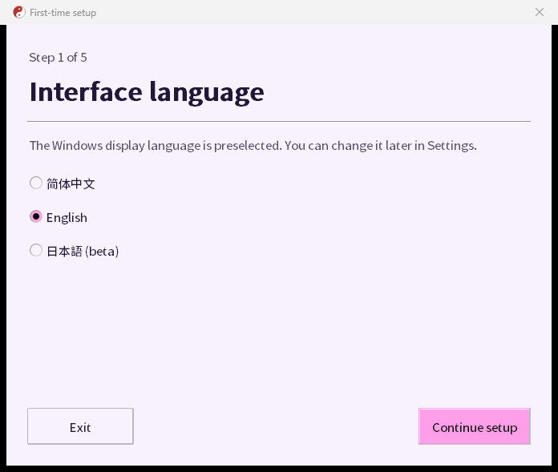
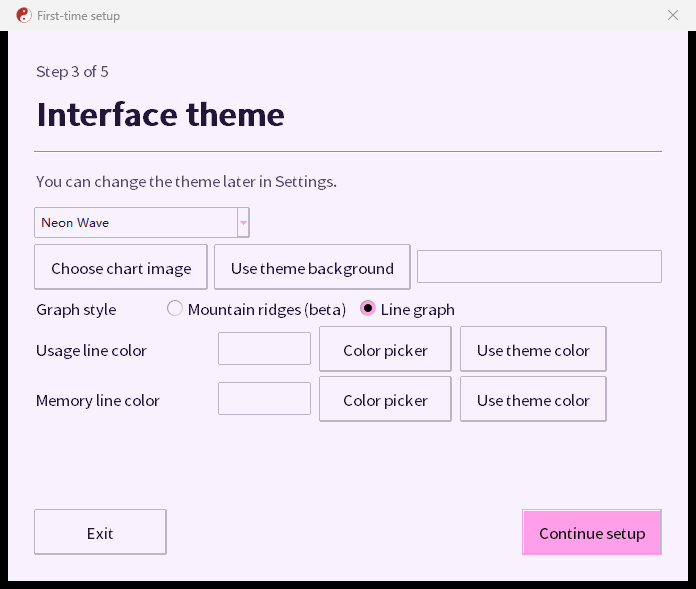
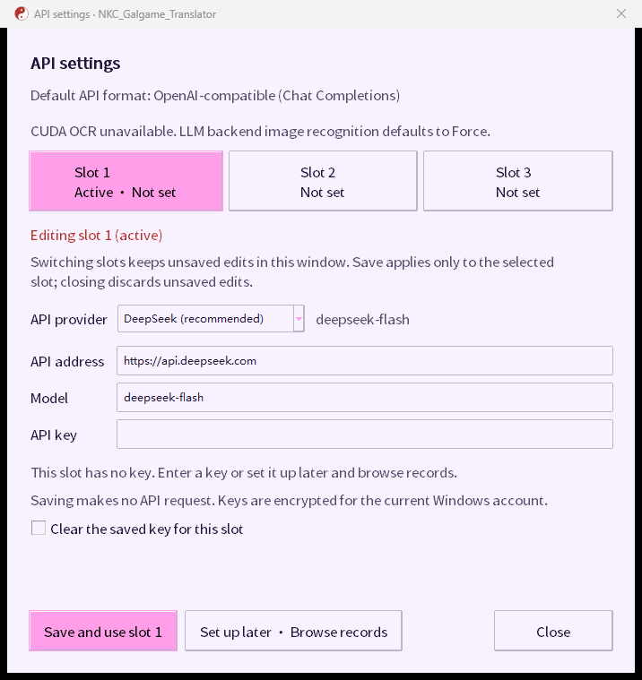
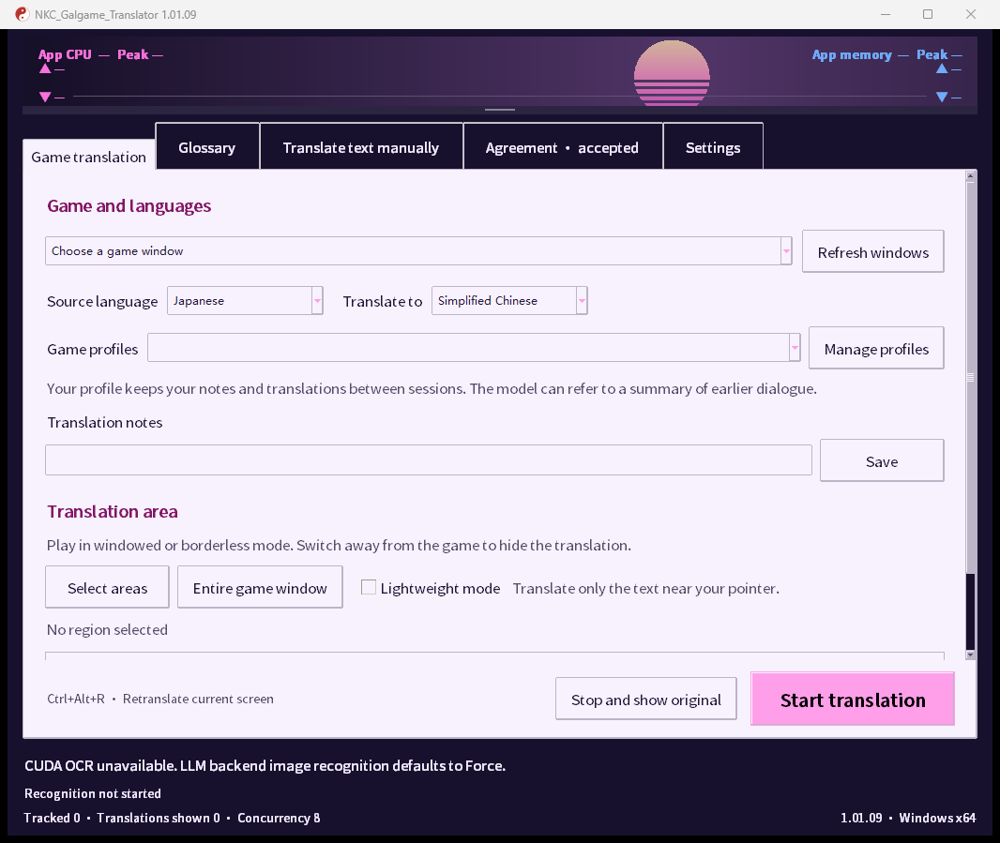

# [Real-Time AI Game Translation] NKC_Galgame_Translator

[English](README.md) · [简体中文](README.zh-CN.md) · [日本語 (beta)](README.ja.md)

The translator reads visible text from the game window and draws the translation in a separate, click-through overlay. This capture and display path runs outside the game process and requires no game hook or code injection.

Read a visual novel in your language without looking away from the dialogue box. NKC_Galgame_Translator reads the selected game window with OCR, samples the background around the lettering and displays the translation where the original text appeared. You can still click choices and advance the dialogue.

The name **NKC** comes from the initials of the Japanese kana reading of **二色蝶**.

**Your automated visual novel localization toolkit** · A “roasting machine” in fan-translation slang: read dialogue in place, then use the optional localization toolkit to capture a page and export its source text and translation for editing.

**Windows x64 · Version 1.01.13 · MIT**

## Try it

Download `NKC_Galgame_Translator-1.01.13-setup.exe` from the release assets. For a portable copy, extract the Windows x64 ZIP and open `NKC_Galgame_Translator.exe`. Local OCR works on the CPU. CUDA OCR is an optional download for compatible NVIDIA systems.

New installations have no per-session request limit. You can set a limit in Settings. Your provider’s usage limits and billing still apply.

[Optional CUDA add-on](https://github.com/Sabour1NX/NKC_Galgame_Translator/releases/download/v1.01.12-install.4/NKC_Galgame_Translator-1.01.12-cuda-addon.zip)

### WinGet

On Windows x64, download the [WinGet manifest](https://github.com/Sabour1NX/NKC_Galgame_Translator/releases/download/v1.01.13/winget-manifest.zip), extract it, then run the following from its parent directory. This requires local manifest support in WinGet.

```powershell
winget install --manifest .\winget
```

### 1. Choose your interface and chart

Choose an install folder and follow the progress bar. On the success screen, launch the translator directly or open the five-page browser tour and launch from its last page. To uninstall, open **Settings → Apps → Installed apps** in Windows. In the portable version, first-time setup starts with the language selector. Read the terms, then choose your theme, OCR settings and whether to enable the localization toolkit.



Every theme starts with **Line graph**. Select **Mountain ridges (beta)** under **Graph style** to add ridges to CPU or GPU utilization. Memory usage stays a plain line. Crowded turns skip new ridges. You can change this later in **Settings → Interface theme**, then **Save settings**.



### 2. Connect a translation model

In **Settings**, open **API connections (3 slots)**. Choose a provider, enter its API address, model ID and API key, then select **Save and use slot 1** (or the slot you edited). The app uses OpenAI-compatible Chat Completions. For Ollama or another local server, start the server and enter the ID of a model it serves. Leave the key blank if the server accepts unauthenticated requests.



Recognized text and relevant game context go to the selected backend. Enabling backend image recognition also sends the selected game region. To browse existing records before choosing a provider, select **Set up later · Browse records**.

### 3. Translate a game window

Start the game in windowed or borderless mode. In **Game translation**, select its window and both languages. Choose **Select areas** and mark one or more dialogue boxes, or choose **Entire game window**. Click **Start translation** and return to the game. If a line was missed, move the pointer near it to prioritize that area. **Lightweight mode** limits translation to nearby text.



Reuse a game profile to keep its terminology and context. The optional localization toolkit saves page screenshots and source/translation pairs as TXT, JSON or CSV.

## Replay first-time setup

Double-click **Preview-Setup.cmd** in the extracted application folder. In the multi-version development workspace, the same command at the project root selects the newest complete public build. Each run opens the real wizard with a fresh temporary profile. Close the preview application to discard its settings and return to your usual profile.

[English manual](docs/PROJECT_MANUAL.en.html) · [Welcome tour](docs/Greeting.en.html) · [Release notes](CHANGELOG.md) · [MIT license](LICENSE) · [Third-party notices](THIRD_PARTY_NOTICES.md)
