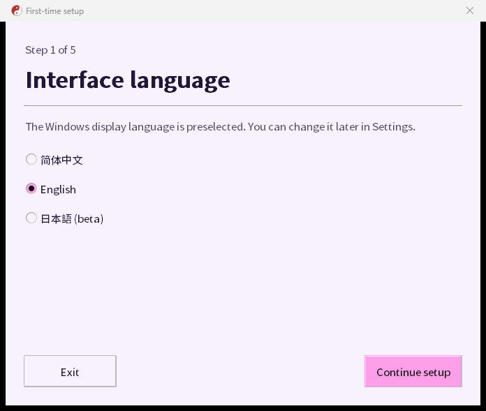
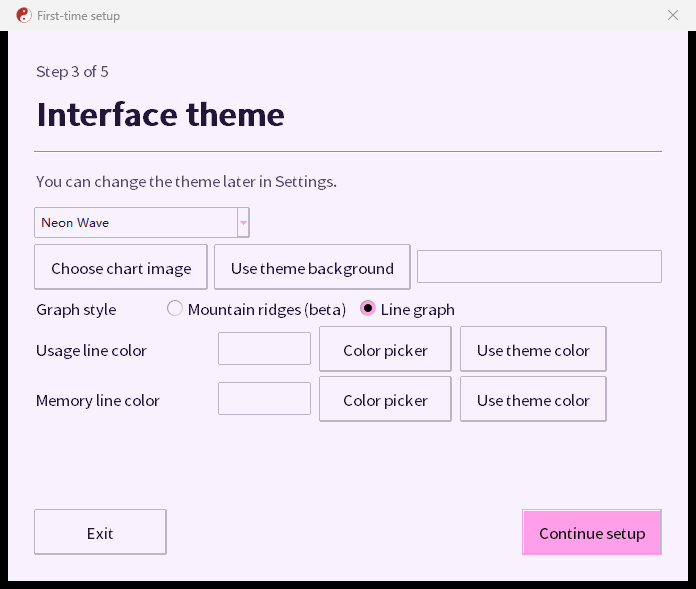
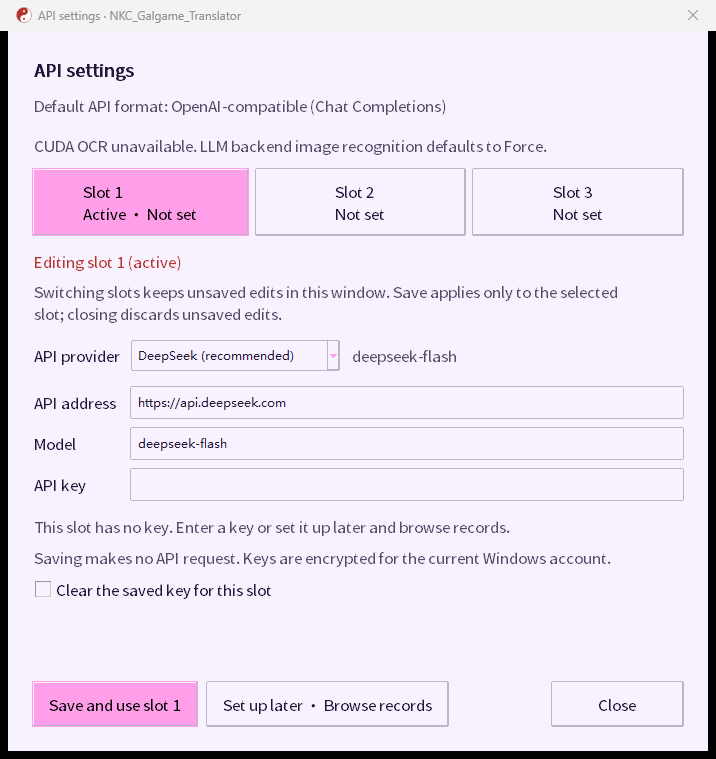
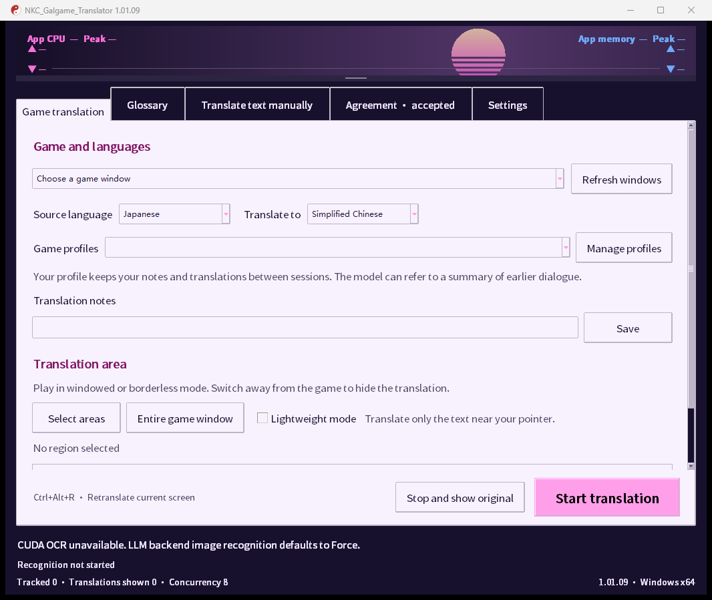

# NKC_Galgame_Translator

[English](README.md) · [简体中文](README.zh-CN.md) · [日本語 (beta)](README.ja.md)

放下词典，回到故事里。二色蝶通过 OCR 读取所选游戏窗口的对白和选项，在文字周围取样背景，再把译文放回原位。读完一句，可以照常点击或按键继续。

**NKC** 取自「二色蝶」日语假名读音的首字母。

**自动化烤肉机** · 玩游戏时，译文直接出现在对白框里。做汉化时，开启汉化组工具，即可保存整页截图和逐句对应的原文、译文，方便后续校对。

**Windows x64 · 1.01.13 · MIT**

## 第一次使用

下载发行附件中的 `NKC_Galgame_Translator-1.01.13-setup.exe`。如果选用免安装版，请先解压 Windows x64 ZIP，再双击 `NKC_Galgame_Translator.exe`。CPU 可运行本地 OCR，使用兼容 NVIDIA 显卡时也可安装独立的 CUDA OCR 扩展。以下截图采用英文界面。

首次使用时，每次启动的翻译请求次数默认不限。可在设置中指定上限；实际用量和费用按所选服务商的规则计算。

[可选 CUDA 扩展包](https://github.com/Sabour1NX/NKC_Galgame_Translator/releases/download/v1.01.12-install.4/NKC_Galgame_Translator-1.01.12-cuda-addon.zip)

### WinGet

下载并解压 [WinGet 清单](https://github.com/Sabour1NX/NKC_Galgame_Translator/releases/download/v1.01.13/winget-manifest.zip)。启用 WinGet 本地清单支持后，在解压目录的上一级运行以下命令。

```powershell
winget install --manifest .\winget
```

### 1. 选择界面语言和图表

选择安装目录后，向导会显示进度。安装成功时，可以直接启动二色蝶，也可以打开浏览器欢迎页，从导览末页启动。卸载入口在 Windows「设置 → 应用 → 已安装的应用」。免安装版首次启动时先选择界面语言。阅读并同意条款后，依次设置主题、OCR 和是否启用汉化组工具。



所有主题默认使用普通折线（Line graph）。在 Graph style 中选择 Mountain ridges (beta)，即可给 CPU 或 GPU 利用率折线加上山脊。内存和显存用量始终以普通折线显示。折点密集时会跳过新山脊。以后也可在「设置 → 界面主题」修改，然后点击「保存设置」。



### 2. 配置翻译模型

在「设置」打开 API 配置，选择一个槽位，填写服务地址、模型 ID 和 API Key，再点击「保存并使用槽位」。默认接口格式为 OpenAI 兼容的 Chat Completions。使用 Ollama 等本地服务时，先启动服务，再填入已加载的模型 ID。服务无需认证时可将密钥留空。



软件会把识别出的文字和相关游戏语境发给所选后端。开启后端识图时，还会发送所选游戏区域的图像。暂时没有接口也可以选择稍后配置，先浏览已保存的记录。

### 3. 开始游戏翻译

以窗口或无边框模式打开游戏。在「游戏实时翻译」选择游戏窗口、原语言和目标语言。用「框选区域」圈出一个或多个对白框，或选择「整个游戏窗口」。点击「开始翻译」后切回游戏。如果有一句漏翻，把鼠标移到文字附近可优先补读。只想翻译鼠标附近的文字时，勾选「轻量模式」。



下次游玩可选回同一个档案，沿用术语和语境。启用汉化组工具后，可按页保存截图，并将原文与译文导出为 TXT、JSON 或 CSV。

## 重新体验初始化

双击解压目录下的 **Preview-Setup.cmd**。开发工作区根目录的同名脚本会自动选择最新的完整公开构建。每次都用新的临时配置打开实际向导；关闭体验窗口后，临时设置随之清理，个人版原有的密钥和档案可继续使用。

[中文手册](docs/PROJECT_MANUAL.html) · [中文欢迎页](docs/Greeting_cn.html) · [版本记录](CHANGELOG.md) · [MIT 许可证](LICENSE) · [第三方组件](THIRD_PARTY_NOTICES.md)
