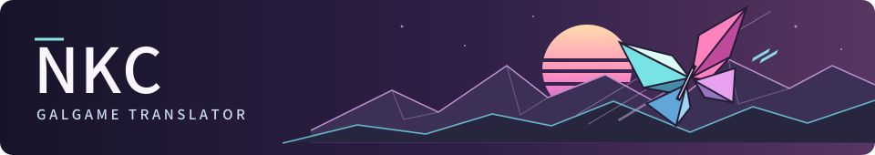
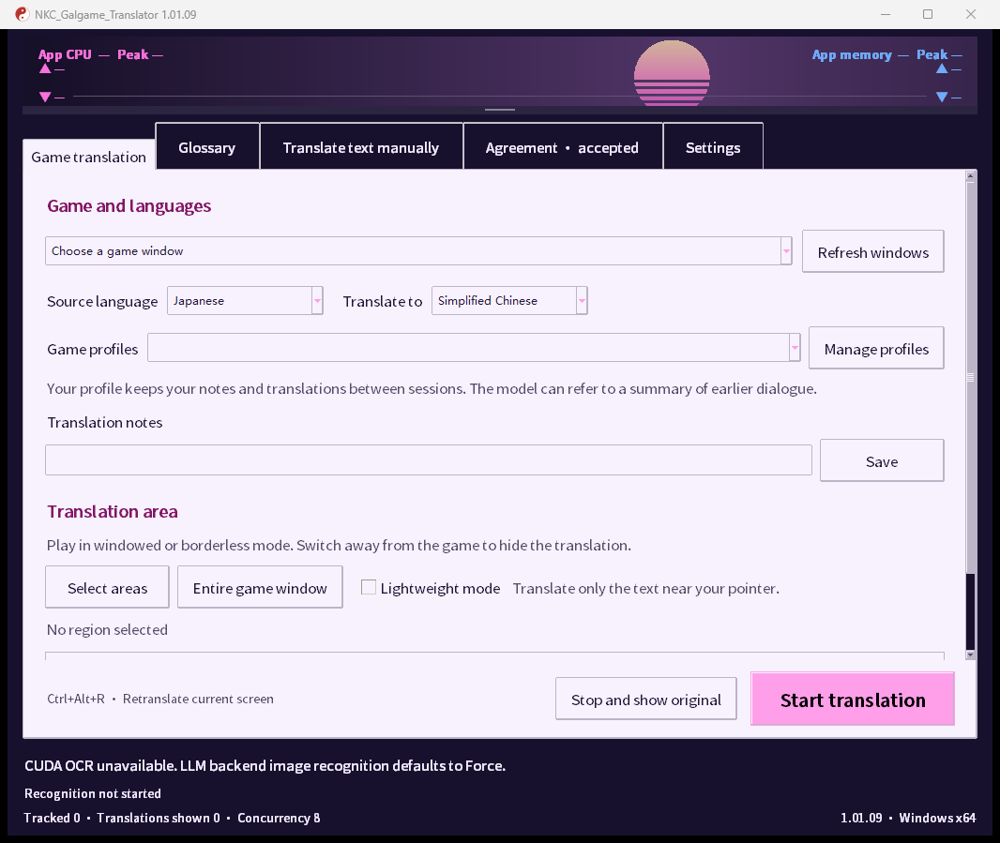

# [Real-Time AI Game Translation] NKC_Galgame_Translator

[English](README.md) · [简体中文](README.zh-CN.md) · [日本語 (beta)](README.ja.md)

ゲーム画面に表示された文字を読み取り、元の位置に独立した Overlay で訳文を表示します。クリックはゲーム側に届きます。画面の取得と表示はゲームの Process の外で行うため、ゲームへの Hook や Code Injection は不要です。



## ビジュアルノベルの自動翻訳・ローカライズツール

中国の翻訳コミュニティでいう「自动化烤肉机」。プレイ中は台詞を元の位置で読み、翻訳作業ではページの画像と原文・訳文の組を保存して校正に使えます。

ゲームの台詞を、いつもの台詞欄で読めます。選んだ Window から台詞や選択肢を OCR で読み取り、文字の周囲から背景を復元して、元の位置に訳文を表示します。選択肢はそのままクリックできます。

**NKC** は「二色蝶」の仮名読みの頭文字を取った略称です。

**Windows x64 · 1.01.13 · MIT**

[Windows Installer をダウンロード](https://github.com/Sabour1NX/NKC_Galgame_Translator/releases/download/v1.01.13/NKC_Galgame_Translator-1.01.13-setup.exe) · [Portable 版と WinGet manifest](https://github.com/Sabour1NX/NKC_Galgame_Translator/releases/tag/v1.01.13) · [画像付きの導入ガイド](1.01.13/README.ja.md)



初期設定では、1 回の起動中に送信できる Request 数は無制限です。上限は設定で変更できます。利用料金と利用制限は接続先の Provider に従います。

[オプションの CUDA Add-on](https://github.com/Sabour1NX/NKC_Galgame_Translator/releases/download/v1.01.12-install.4/NKC_Galgame_Translator-1.01.12-cuda-addon.zip)

## 翻訳を始める

1. ゲームを Window または Borderless モードで開きます。翻訳アプリの「設定 → API 接続設定」で、OpenAI 互換の Endpoint、Model ID、API Key を入力します。Ollama などの Local server にも接続できます。
2. 「ゲーム翻訳」でゲームの Window と翻訳元・翻訳先の言語を選びます。台詞欄を一つずつ指定することも、Window 全体を対象にすることもできます。
3. 翻訳を開始してゲームに戻ります。訳が出ない行には Pointer を近づけると、その周辺が優先されます。軽量モードでは Pointer の近くにある文字だけを翻訳します。

OCR は手元の PC の CPU で動作します。対応する NVIDIA GPU では CUDA Add-on も利用できます。読み取った文字と関連する文脈は、選んだ Backend に送信されます。Backend の画像認識を有効にすると、選択範囲の画像も送信されます。同じゲームの Profile を開くと、用語と文脈を引き継げます。

## Source code

| Component | 役割 |
| --- | --- |
| [Windows Native layer](1.01.13/native) | C++ による Window の取得、背景復元、文字配置、Overlay の描画 |
| [翻訳アプリ](1.01.13/nkc_galgame_translator) | Python による UI、OCR の実行制御、Scroll の追跡、Pointer 周辺の再認識、Streaming 翻訳、ゲームの Profile 管理 |
| [Build・検証ツール](1.01.13/tools) | OCR Helper、配布物の作成、Installer の言語切り替え、字幕マスクの再現試験、DLL の検査 |
| [Tests](1.01.13/tests) | 文字の追跡、描画、翻訳処理、Install 動作の回帰テスト |
| [WinGet manifests](1.01.13/winget) | Package 情報、Installer の Hash、言語別の起動引数 |

次の例では Native layer を Build し、二つの回帰テストを実行します。Windows x64、MSVC C++ Build Tools、プロジェクトの Python 実行・テスト用の依存関係が必要です。配布版には CPython 3.14.10 x64 を使用します。配布物を作る場合は、Build script に記載された OCR 用の Wheel と言語 Model も用意してください。

```powershell
cd 1.01.13
.\native\build.ps1
python -m pytest -q tests/test_tracking.py tests/test_native_aero.py
```

[Build script と必要な環境](1.01.13/tools/package.ps1) · [Architecture](1.01.13/docs/ARCHITECTURE.md) · [API reference](1.01.13/docs/API.md) · [MIT License](LICENSE) · [Third-party notices](1.01.13/THIRD_PARTY_NOTICES.md)
