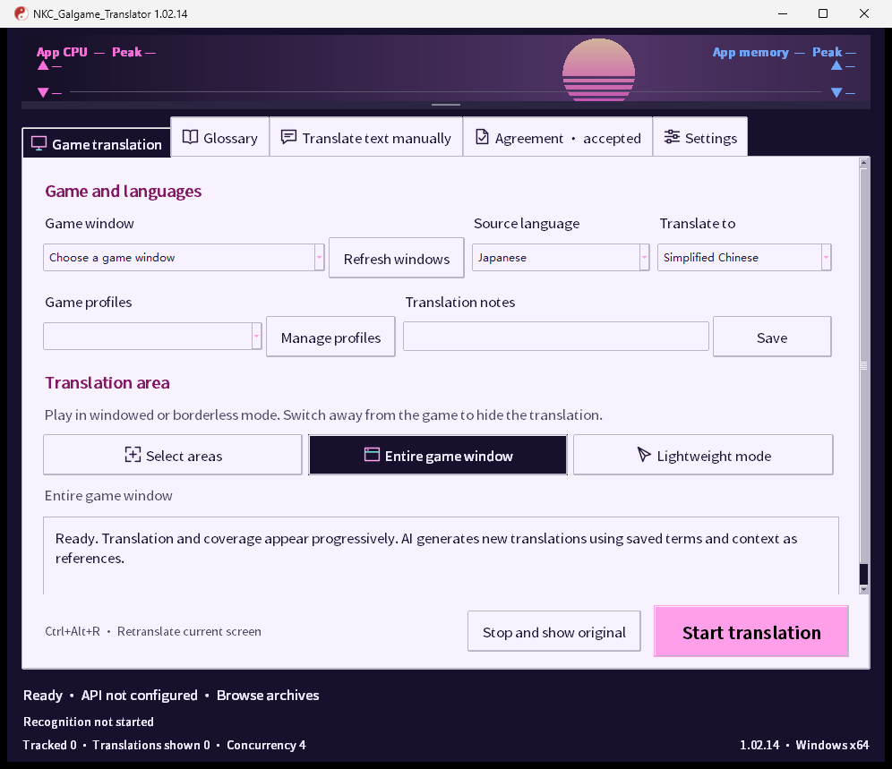

# [Real-Time AI Game Translation] NKC_Galgame_Translator

[English](README.md) · [简体中文](README.zh-CN.md) · [日本語 (beta)](README.ja.md)

The translator reads visible text from the game window and draws the translation in a separate, click-through overlay. This capture and display path runs outside the game process and requires no game hook or code injection.


## Your automated visual novel localization toolkit

A “roasting machine” in fan-translation slang: read dialogue in place, then use the optional localization toolkit to capture a page and export its source text and translation for editing.

Read visual novels in translation without looking away from the dialogue box. NKC_Galgame_Translator captures a selected Windows game window, recognizes dialogue and menu text, samples the background around the letters, and draws the translation in place. Choices stay clickable.

The name **NKC** comes from the initials of the Japanese kana reading of **二色蝶**.

**Windows x64 · 1.02.14 · MIT**

The redesigned main window uses eight icons for its tabs and capture modes. Start and stop stay below the scrollable controls.

[Download the Windows installer](https://github.com/Sabour1NX/NKC_Galgame_Translator/releases/download/v1.02.14/NKC_Galgame_Translator-1.02.14-setup.exe) · [Portable build and WinGet manifest](https://github.com/Sabour1NX/NKC_Galgame_Translator/releases/tag/v1.02.14) · [Illustrated setup guide](1.02.14/README.md)



New installations have no per-session request limit. You can set a limit in Settings. Your provider’s usage limits and billing still apply.

[Optional CUDA add-on](https://github.com/Sabour1NX/NKC_Galgame_Translator/releases/download/v1.01.12-install.4/NKC_Galgame_Translator-1.01.12-cuda-addon.zip)

## Start translating

1. Open a game in windowed or borderless mode. In the translator, open **Settings → API connections** and enter the endpoint, model ID and credentials for an OpenAI-compatible backend. Ollama and other compatible local servers are supported.
2. In **Game translation**, select the game window, source language and target language. Select individual dialogue areas or the entire window.
3. Select **Start translation** and return to the game. For a missed line, move the pointer near it. **Lightweight mode** translates only nearby text.

OCR runs locally on the CPU, with an optional CUDA add-on for compatible NVIDIA GPUs. Recognized text and relevant game context go to your selected translation backend. Turning on backend image recognition also sends the selected image region. A game profile keeps terminology and context between sessions.

## Inside the source

| Component | What it does |
| --- | --- |
| [Native Windows layer](1.02.14/native) | C++ window capture, background reconstruction, text layout and overlay rendering |
| [Translation application](1.02.14/nkc_galgame_translator) | Python UI, OCR scheduling, scroll tracking, pointer attention, streaming translation and game profiles |
| [Build and verification tools](1.02.14/tools) | OCR helpers, packaging, installer localization, subtitle-mask replay and native DLL checks |
| [Tests](1.02.14/tests) | Regression tests for text tracking, rendering, translation and installation |
| [WinGet manifests](1.02.14/winget) | Package metadata, installer hashes and language-specific installation switches |

To build the native layer and run two focused test suites, use Windows x64 with the MSVC C++ build tools and the project’s Python runtime and test dependencies. The release build uses CPython 3.14.10 x64. Packaging also requires the OCR wheels and language models listed in the build script.

```powershell
cd 1.02.14
.\native\build.ps1
python -m pytest -q tests/test_tracking.py tests/test_native_aero.py
```

[Build script and prerequisites](1.02.14/tools/package.ps1) · [Architecture](1.02.14/docs/ARCHITECTURE.md) · [API reference](1.02.14/docs/API.md) · [License](LICENSE) · [Third-party notices](1.02.14/THIRD_PARTY_NOTICES.md)
