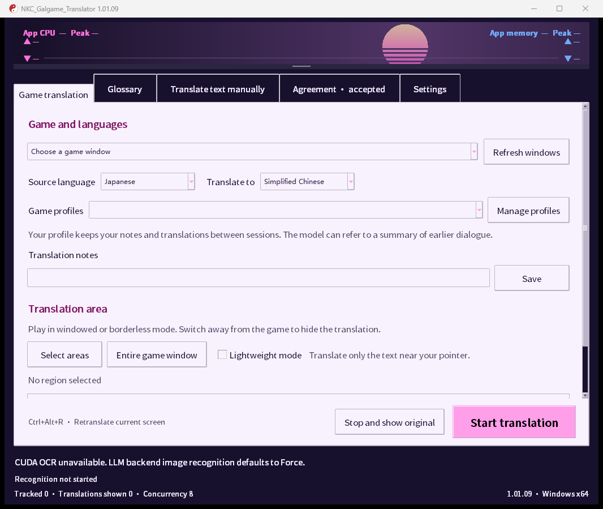

# 二色蝶 Galgame 翻译

[English](README.md) · [简体中文](README.zh-CN.md) · [日本語 (beta)](README.ja.md)

二色蝶读取选定游戏窗口里的对白和菜单，在原文字周围取样还原背景，再把译文画回原位。读完一句，可以直接点选项、继续剧情。

**NKC** 取自「二色蝶」日语假名读音的首字母。

**Windows x64 · 1.01.12 · MIT**

[下载 Windows 安装程序](https://github.com/Sabour1NX/NKC_Galgame_Translator/releases/download/v1.01.12-install.2/NKC_Galgame_Translator-1.01.12-setup.exe) · [便携版和 WinGet 清单](https://github.com/Sabour1NX/NKC_Galgame_Translator/releases/tag/v1.01.12-install.2) · [图文入门指南](1.01.12/README.zh-CN.md)



## 开始翻译

1. 以窗口或无边框模式启动游戏。在二色蝶的「设置 → API 配置」中填写兼容 OpenAI 接口的服务地址、模型名称和密钥，也可连接 Ollama 等本地服务。
2. 在「游戏实时翻译」中选中游戏窗口、原语言和目标语言。可以框选一个或多个对白区域，也可以选择整个窗口。
3. 点击「开始翻译」并切回游戏。遇到漏翻，把鼠标移到那行文字附近即可优先识别。勾选「轻量模式」后，只翻译指针附近的文字。

OCR 默认可在本机 CPU 上运行，兼容的 NVIDIA 显卡可另装 CUDA 扩展。识别出的文字和相关语境会发送给选定的翻译后端；开启后端识图还会发送选定区域的图像。重复打开同一游戏档案，可以沿用术语和语境。

## 源码导航

| 模块 | 用途 |
| --- | --- |
| [Windows 原生层](1.01.12/native) | 用 C++ 捕获窗口、还原文字背景、计算排版并绘制覆盖层 |
| [翻译主程序](1.01.12/nkc_galgame_translator) | 用 Python 实现界面、OCR 调度、滚动跟踪、鼠标补译、流式翻译和游戏档案 |
| [构建与验证工具](1.01.12/tools) | OCR 辅助进程、打包、安装语言适配、字幕遮罩回放和 DLL 检查 |
| [测试](1.01.12/tests) | 覆盖文本跟踪、渲染、翻译流程和安装行为 |
| [WinGet 清单](1.01.12/winget) | 包信息、安装包哈希和按语言选择的安装参数 |

以下示例编译原生层并运行两组回归测试。需要 Windows x64、MSVC C++ 构建工具，以及项目的 Python 运行和测试依赖。发行包采用 CPython 3.14.10 x64，完整打包还需要构建脚本列出的 OCR 依赖和语言模型。

```powershell
cd 1.01.12
.\native\build.ps1
python -m pytest -q tests/test_tracking.py tests/test_native_aero.py
```

[构建脚本与前置条件](1.01.12/tools/package.ps1) · [项目架构](1.01.12/docs/ARCHITECTURE.md) · [接口规范](1.01.12/docs/API.md) · [MIT 许可](LICENSE) · [第三方组件说明](1.01.12/THIRD_PARTY_NOTICES.md)
